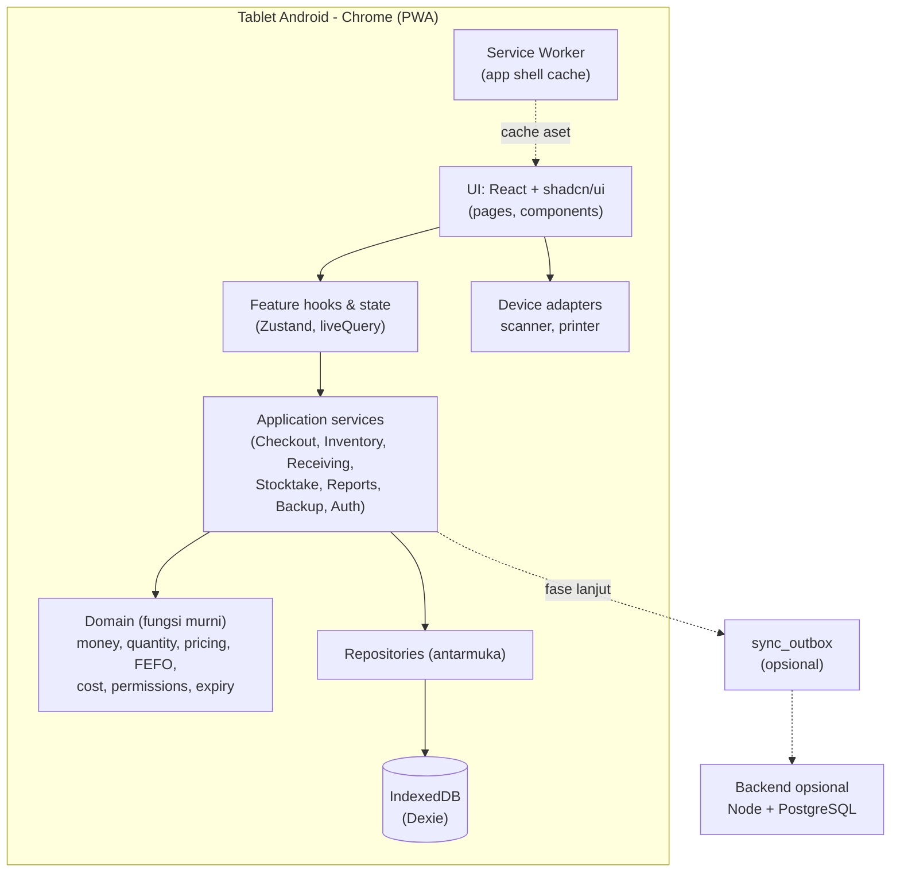
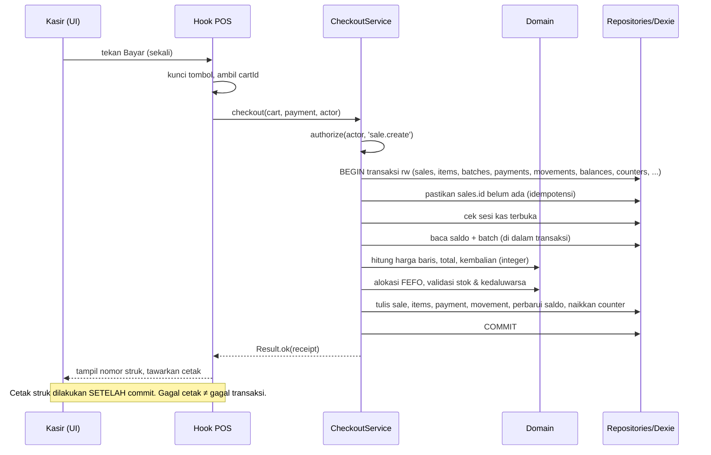

# ARCHITECTURE — SembakoOS

Penjelasan bagaimana bagian-bagian aplikasi saling terhubung, dan aturan yang menjaga arsitektur tetap rapi saat proyek membesar.

| Atribut | Nilai |
| --- | --- |
| Versi dokumen | 1.0 |
| Tanggal | 24 Oktober 2026 |
| Mengacu ke | `PRD.md` v1.1, `DATABASE.md`, `DESIGN_SYSTEM.md` |
| Status keputusan | Teknologi pada §2 berstatus **[USULAN]** kecuali ditandai *(dari PRD)*; ringkasan keputusan di §19 |

---

## Daftar Isi

1. [Tujuan dan Prinsip Arsitektur](#1-tujuan-dan-prinsip-arsitektur)
2. [Teknologi yang Digunakan](#2-teknologi-yang-digunakan)
3. [Gambaran Sistem](#3-gambaran-sistem)
4. [Struktur Folder](#4-struktur-folder)
5. [Lapisan dan Aturan Dependensi](#5-lapisan-dan-aturan-dependensi)
6. [Alur Data Antarfitur](#6-alur-data-antarfitur)
7. [Autentikasi dan Otorisasi](#7-autentikasi-dan-otorisasi)
8. [Offline dan PWA](#8-offline-dan-pwa)
9. [Sinkronisasi dan Penanganan Konflik](#9-sinkronisasi-dan-penanganan-konflik)
10. [Integrasi Perangkat](#10-integrasi-perangkat)
11. [Pencarian dan Performa](#11-pencarian-dan-performa)
12. [Uang, Kuantitas, dan Waktu](#12-uang-kuantitas-dan-waktu)
13. [Penanganan Galat dan Logging](#13-penanganan-galat-dan-logging)
14. [Keamanan](#14-keamanan)
15. [Backup dan Restore (Teknis)](#15-backup-dan-restore-teknis)
16. [Build, Kualitas, dan CI](#16-build-kualitas-dan-ci)
17. [Evolusi Arsitektur](#17-evolusi-arsitektur)
18. [Risiko Teknis](#18-risiko-teknis)
19. [Catatan Keputusan Arsitektur (ADR)](#19-catatan-keputusan-arsitektur-adr)

---

## 1. Tujuan dan Prinsip Arsitektur

**Tujuan:** aplikasi kasir dan stok yang **benar, tahan gangguan, dan mudah diubah** untuk satu toko, berjalan di browser tablet Android tanpa bergantung pada internet.

| # | Prinsip | Konsekuensi |
| --- | --- | --- |
| AP-01 | **Database lokal adalah sumber kebenaran** pada perangkat | Tidak ada fitur inti yang membutuhkan server |
| AP-02 | **Logika bisnis terpisah dari UI** | Aturan harga, stok, dan izin ada di lapisan domain/service, bisa diuji tanpa browser |
| AP-03 | **Satu pintu untuk setiap jenis perubahan** | Semua perubahan stok lewat `InventoryService`; semua pengecekan izin lewat `authorize()` |
| AP-04 | **Operasi bisnis bersifat atomik** | Satu transaksi database per operasi bisnis; tidak ada status setengah jadi |
| AP-05 | **Ledger dulu, saldo turunan** | Movement tidak pernah diubah; saldo diperbarui dalam transaksi yang sama dan dapat direkonsiliasi |
| AP-06 | **UI hanya menampilkan dan meminta** | State UI (keranjang, filter) bukan sumber kebenaran stok atau uang |
| AP-07 | **Mudah diganti di tepi** | Penyimpanan, printer, scanner, dan (kelak) sinkronisasi berada di balik antarmuka |
| AP-08 | **Sederhana sebelum canggih** | Tidak ada backend, antrean, atau caching rumit sebelum dibutuhkan |

---

## 2. Teknologi yang Digunakan

| Lapisan | Pilihan | Alasan | Alternatif yang dipertimbangkan |
| --- | --- | --- | --- |
| Bahasa | **TypeScript** (mode `strict`) | Keamanan tipe untuk logika uang/stok | — |
| UI framework | **React** *(dari PRD)* + **Vite** | Ekosistem shadcn/ui; build cepat; mendukung PWA | Next.js (tidak perlu SSR; menambah kerumitan offline) |
| Styling & komponen | **Tailwind CSS + shadcn/ui** *(dari PRD)* + Lucide | Keputusan produk C-01 | — |
| Routing | **React Router** (mode data/SPA) | Cukup untuk SPA offline | TanStack Router |
| State UI | **Zustand** untuk keranjang dan state UI lokal | Kecil, sederhana, mudah diuji | Redux Toolkit |
| Pengambilan data lokal | **Dexie `liveQuery`** (dan/atau TanStack Query sebagai pembungkus) | Tampilan reaktif terhadap perubahan database lokal | — |
| Form & validasi | **React Hook Form + Zod** *(dari PRD)* | Skema Zod dipakai ulang di UI dan service | — |
| Penyimpanan lokal | **IndexedDB via Dexie** *(dari PRD)* | Transaksi atomik, tersedia di browser Android | SQLite WASM/OPFS (lihat §17) |
| PWA | **vite-plugin-pwa (Workbox)** | Precache app shell, pembaruan terkontrol | Service worker manual |
| Pencarian produk | **MiniSearch** (indeks di memori) | Pencarian nama toleran-ketik, ringan | Fuse.js |
| Grafik | **Recharts** (lewat komponen `chart` shadcn) | Selaras shadcn/ui | — |
| Tanggal | **date-fns** + `@date-fns/tz` | Batas hari zona waktu toko | Temporal (belum stabil di semua browser) |
| Hash PIN | **Web Crypto PBKDF2-SHA256** | Tanpa dependensi, tersedia offline | Argon2 via WASM (opsional kelak) |
| Pengujian | **Vitest, React Testing Library, fake-indexeddb, fast-check, Playwright, axe-core** | Lihat `TESTING.md` | Jest, Cypress |
| Backend (opsional, fase lanjut) | **Node.js + PostgreSQL** *(dari PRD)* | Hanya untuk backup cloud/sinkronisasi | — |
| Pembungkus native (opsional) | **Capacitor** | Bila scanner/printer tidak dapat dijangkau dari browser | — |

> **Catatan shadcn/ui:** shadcn/ui adalah komponen web React, bukan widget native Android. Jika kebutuhan berubah menjadi APK native murni, pilihan UI harus dievaluasi ulang (`PRD.md` C-02).

---

## 3. Gambaran Sistem



**Cara membaca:** semua jalur penting (garis tebal) berada di dalam perangkat. Garis putus-putus adalah komponen opsional fase lanjutan.

---

## 4. Struktur Folder

```
sembako-os/
├─ AGENTS.md  PRD.md  DESIGN_SYSTEM.md  ARCHITECTURE.md  DATABASE.md
├─ TASKS.md   TESTING.md  CHANGELOG.md
├─ docs/design/orbit-reference.png
├─ public/                      # ikon PWA, font woff2 (self-hosted)
├─ src/
│  ├─ app/                      # bootstrap: router, providers, layout, guards
│  ├─ components/
│  │  ├─ ui/                    # hasil CLI shadcn (jangan diedit)
│  │  └─ shared/                # komponen aplikasi: MoneyText, ScanInput, Numpad, ...
│  ├─ features/                 # satu folder per modul PRD
│  │  ├─ auth/  catalog/  pos/  inventory/  expiry/
│  │  ├─ suppliers/  reports/  backup/  settings/  audit/
│  │  │   └─ {pages, components, hooks, schemas}/
│  ├─ services/                 # application services (orkestrasi use case)
│  ├─ domain/                   # LOGIKA MURNI, tanpa React/Dexie
│  │  ├─ money/  quantity/  pricing/  inventory/  expiry/
│  │  ├─ cost/   sales/     permissions/  numbering/  time/
│  ├─ data/
│  │  ├─ db.ts                  # deklarasi Dexie + versi
│  │  ├─ migrations/
│  │  ├─ repositories/          # akses data per agregat
│  │  └─ search/                # indeks pencarian di memori
│  ├─ devices/                  # adapter scanner, printer, bunyi
│  ├─ lib/                      # format, copy (teks UI), utilitas umum
│  └─ styles/globals.css        # token desain
├─ tests/
│  ├─ unit/  integration/  e2e/  fixtures/  helpers/
└─ scripts/                     # seed demo, cek konsistensi, dsb.
```

Aturan penamaan: berkas komponen `PascalCase.tsx`, selain itu `kebab-case.ts`; satu komponen utama per berkas; berkas > 300 baris dipecah.

---

## 5. Lapisan dan Aturan Dependensi

```
UI (components, pages)
   ↓ memanggil
Feature hooks
   ↓ memanggil
Application services   ← satu use case = satu fungsi
   ↓ memakai                    ↓ memakai
Domain (murni)         Repositories (antarmuka)
                              ↓ diimplementasikan oleh
                       Data (Dexie)
```

| Lapisan | Boleh mengimpor | **Dilarang** mengimpor |
| --- | --- | --- |
| `domain/` | `domain/` lain, pustaka murni (date-fns) | React, Dexie, `services/`, `data/`, `devices/`, browser API |
| `services/` | `domain/`, antarmuka repository, `lib/` | React, komponen, Dexie langsung |
| `data/` | `domain/` (tipe), Dexie | React, `services/`, `features/` |
| `features/`, `components/` | `services/` (lewat hook), `domain/` (tipe & format), `lib/` | `data/` (tidak boleh akses Dexie langsung dari UI) |
| `devices/` | `lib/` | `data/`, `services/` |

Penegakan: aturan `eslint-plugin-boundaries` (atau `import/no-restricted-paths`) dikonfigurasi di Fase 0 dan dijalankan di CI. Pelanggaran = build gagal.

**Aturan khusus:**
- **Satu pintu stok:** hanya `InventoryService` (dan use case yang memanggilnya dalam transaksi yang sama) yang menulis `stock_movements`, `stock_movement_items`, dan `inventory_balances`. Repository tidak menyediakan `update` saldo secara langsung.
- **Satu pintu izin:** setiap method service yang mengubah data atau membaca data sensitif memanggil `authorize(actor, permission)` di baris pertama.
- **Waktu dan ID disuntikkan** (`Clock`, `IdGenerator`) ke service agar dapat diuji deterministik; domain tidak memanggil `Date.now()` atau `crypto.randomUUID()` langsung.
- **Hasil operasi** memakai tipe `Result<T, AppError>` untuk galat yang dapat diprediksi (stok kurang, izin ditolak); `throw` hanya untuk bug/kegagalan tak terduga.

---

## 6. Alur Data Antarfitur

### 6.1 Checkout (penjualan tunai)



Jika langkah mana pun gagal sebelum COMMIT, transaksi dibatalkan, `Result.err` dikembalikan, keranjang tidak berubah, dan UI **tidak** menampilkan sukses. Jika commit berhasil tetapi UI gagal menerima respons (aplikasi tertutup), saat dibuka kembali transaksi tetap ada; mengulang `checkout` dengan `cartId` yang sama dikenali sebagai duplikat dan dikembalikan sebagai sukses idempoten tanpa menulis ulang.

Pseudo-kode inti:

```ts
export async function checkout(input: CheckoutInput, ctx: Ctx): Promise<Result<Receipt, AppError>> {
  authorize(ctx.actor, 'sale.create');
  return ctx.db.transaction('rw', ctx.tables.checkout, async () => {
    const existing = await ctx.repos.sales.getById(input.cartId);
    if (existing) return ok(toReceipt(existing));            // idempoten

    const session = await ctx.repos.sessions.requireOpen(ctx.deviceId);   // BR-21
    const products = await ctx.repos.catalog.loadForCart(input.lines);
    const priced   = priceCart(input.lines, products, input.discounts);  // domain, integer
    const stock    = await ctx.repos.inventory.loadBalances(priced.productIds);
    const alloc    = allocateStock(priced, stock, ctx.policy, ctx.clock.now()); // FEFO, blokir kedaluwarsa
    if (!alloc.ok) return err(alloc.error);                  // → rollback otomatis

    const pay = settleCash(priced.total, input.amountReceived);  // kembalian
    if (!pay.ok) return err(pay.error);

    const receiptNo = await ctx.repos.counters.nextReceiptNo(ctx.deviceCode, ctx.clock.now());
    await ctx.repos.sales.insertAll({ priced, alloc, pay, receiptNo, session });
    await ctx.inventory.applyMovement(sale(alloc), ctx);     // satu pintu stok
    await ctx.audit.recordIfNeeded(priced, input.approval, ctx);
    return ok(toReceipt(...));
  });
}
```

> `return err(...)` di dalam transaksi Dexie **tidak** membatalkan transaksi dengan sendirinya. Implementasi harus melempar sentinel (`throw new Abort(err)`) di dalam transaksi dan menangkapnya di luar untuk mengubahnya menjadi `Result.err`. Perilaku ini wajib diuji (`TESTING.md` skenario S-02).

### 6.2 Penerimaan Barang
`ReceivingService.post(receiptId)`: authorize → transaksi → ubah status draft→posted → buat/gabung `product_batches` → `InventoryService.applyMovement(RECEIPT)` → hitung ulang `avg_cost_x10k` (weighted average, BR-26) → catat `price_history` bila biaya berubah → audit.

### 6.3 Void dan Retur
`SalesService.void()` / `ReturnsService.create()`: authorize (+ `ApprovalService` bila perlu) → transaksi → validasi aturan (sesi sama / batas hari / sisa kuantitas) → buat movement reversal atau restock sesuai kondisi → ubah status penjualan → audit. Transaksi asli tidak dihapus.

### 6.4 Stok Opname
`StocktakeService`: buat sesi → `recordCount(item)` menyimpan `system_qty_snapshot` saat dihitung → `submitForReview` → `post` (Supervisor): transaksi yang menerapkan `counted − snapshot` ke saldo terkini dengan movement `STOCKTAKE_ADJUSTMENT` + audit.

### 6.5 Sesi Kas
`SessionService.open/close`: `close` menghitung `expected_cash` dari pembayaran tunai pada sesi, mengisi `variance`, mewajibkan catatan bila ≠ 0, mencatat audit bila selisih.

### 6.6 Laporan
`ReportService` membaca lewat repository dengan agregasi di kode (rentang tanggal dari indeks `completed_at`/`occurred_at`), mengikuti definisi metrik `PRD.md` §7.7. Laporan **tidak menulis** data. Hasil besar dihitung bertahap (cursor) agar UI tidak membeku.

### 6.7 Pembaruan Tampilan
UI berlangganan `liveQuery` ke tabel relevan (daftar produk, stok, riwayat) sehingga tampilan otomatis menyegarkan setelah transaksi tanpa pengelolaan cache manual.

---

## 7. Autentikasi dan Otorisasi

### 7.1 Autentikasi (PIN lokal)

| Aspek | Keputusan |
| --- | --- |
| Metode | PIN per pengguna; panjang minimum dari `security.pin_min_length` (bawaan 6) |
| Penyimpanan | `pin_hash` = PBKDF2-SHA256, salt acak 16 byte per pengguna, jumlah iterasi disimpan di `users.pin_iterations` (target ≥ 310.000; sesuaikan agar verifikasi ≤ ~500 ms di tablet target) |
| Pembatasan percobaan | `failed_attempts` naik tiap PIN salah; setelah 5 kali, `locked_until` = sekarang + jeda yang bertambah (mis. 30 dtk, 1 mnt, 5 mnt); tercatat di audit |
| Sesi aplikasi | Disimpan **di memori** (store), bukan `localStorage`. Memuat ulang halaman = kembali ke layar PIN (dapat dipilih "ingat pengguna terakhir" tanpa melewati PIN) |
| Kunci layar | Timer tidak aktif (`security.autolock_minutes`); keranjang yang belum dibayar dipertahankan di memori + `held_carts` saat terkunci |
| Pengguna pertama | Dibuat di setup awal (FR-SET-01); tidak ada kredensial bawaan |

> **Batasan yang jujur:** PIN di perangkat lokal adalah **kontrol akses operasional**, bukan perlindungan kriptografi data. Seseorang dengan akses fisik ke perangkat dan alat pengembang browser dapat membaca IndexedDB. Mitigasi: perangkat khusus kasir, kunci layar OS, backup terenkripsi (opsional), dan tidak menyimpan data sangat sensitif (kartu, dsb.).

### 7.2 Otorisasi

- Izin didefinisikan sebagai peta statis di `domain/permissions` berdasarkan matriks `PRD.md` §5.2, contoh: `sale.create`, `sale.void`, `sale.discount.apply`, `catalog.price.edit`, `stock.adjust`, `stocktake.post`, `report.sales.view`, `backup.restore`, `user.manage`.
- `authorize(actor, permission, context?)` melempar/mengembalikan `AppError('FORBIDDEN')`; dipanggil di **service**, bukan hanya di UI. UI hanya memakai `can()` untuk menyembunyikan menu/tombol.
- **Approval:** bila `authorize` mengembalikan `NEEDS_APPROVAL` (mis. diskon di atas batas), UI menampilkan `ApprovalDialog`. Service memverifikasi PIN pemberi izin (peran ≥ Supervisor), membuat entri `approvals`, dan melampirkan `approval_id` pada operasi. Approval tidak dapat dipakai ulang untuk operasi lain.
- Izin dievaluasi saat operasi berjalan (bukan di-cache dari login) sehingga perubahan peran berlaku segera.
- Semua penolakan izin dan Approval tercatat di audit bila menyangkut aksi sensitif.

---

## 8. Offline dan PWA

Offline bukan sekadar menyimpan halaman di cache. Pembagian tugas:

| Aspek | Penanggung jawab |
| --- | --- |
| Membuka aplikasi tanpa internet | **Service worker** (precache aset: JS, CSS, font, ikon) |
| Menyimpan dan membaca data bisnis | **IndexedDB** (Dexie), bukan Cache API, bukan `localStorage` |
| Menyimpan keranjang sementara | Zustand (memori) + `held_carts` |
| Menyimpan konfigurasi | `app_settings` |

### 8.1 Service worker dan pembaruan
- Strategi: **precache** semua aset build; navigasi jatuh ke `index.html` (SPA). Tidak ada cache untuk panggilan API bisnis (tidak ada API di MVP).
- **Pembaruan terkontrol:** versi baru diunduh di latar; pengguna diberi pilihan "Perbarui sekarang" **hanya saat tidak ada keranjang aktif atau dialog pembayaran**. Tidak ada `skipWaiting` otomatis di tengah transaksi.
- Pembaruan yang mengubah skema memicu alur migrasi dengan backup pengaman (`DATABASE.md` §8).

### 8.2 Ketahanan penyimpanan
- Panggil `navigator.storage.persist()` saat setup awal; simpan hasilnya di `app_settings`. Jika **tidak** diberikan, tampilkan peringatan tetap di Pengaturan dan chip status (risiko R-01 `PRD.md`).
- Pantau `navigator.storage.estimate()`; peringatan di ≥ 80% kuota.
- Tangani `QuotaExceededError` dan `AbortError` saat transaksi: tampilkan galat jelas, jangan menandai sukses.
- Pengingat backup (FR-BKP-05) adalah mitigasi utama kehilangan data karena pembersihan browser atau perangkat rusak.
- Pasang aplikasi ke layar utama (PWA terpasang) meningkatkan peluang penyimpanan persisten; masukkan ke panduan setup.

### 8.3 Beberapa tab / jendela
IndexedDB dapat dibuka dari beberapa tab sekaligus. Risiko: dua tab melakukan checkout bersamaan.
- Transaksi IndexedDB menjamin atomik dan terserialisasi per tabel; karena **baca-ubah-tulis dilakukan dalam transaksi yang sama** (§5), dua tab tidak dapat menimbulkan stok ganda.
- Tambahan: `navigator.locks` (Web Locks) menjaga **satu tab aktif** untuk layar POS; tab lain menampilkan "Aplikasi sudah terbuka di jendela lain".
- Penanganan `versionchange`: bila tab lama memegang koneksi saat migrasi, tab lama ditutup dengan pesan.

### 8.4 Indikator status
`SyncStatusChip` menampilkan `navigator.onLine` hanya sebagai informasi (tidak menentukan perilaku), ditambah status penyimpanan lokal. Aplikasi **tidak** pernah memblokir fitur karena offline.

---

## 9. Sinkronisasi dan Penanganan Konflik

**MVP: tidak ada sinkronisasi.** Satu perangkat, satu database lokal sebagai sumber kebenaran (`PRD.md` A-01). Arsitektur disiapkan agar sinkronisasi dapat ditambahkan **tanpa menulis ulang data**:

- ID UUID v7 tahan bentrok; nomor dokumen memuat kode perangkat.
- Movement stok bersifat **peristiwa append-only**, bukan angka saldo.
- `row_version` pada tabel entitas; tabel `sync_outbox` direncanakan.

### 9.1 Aturan desain bila sinkronisasi diaktifkan (fase 6)
Fitur ini **tidak boleh diaktifkan** sebelum aturan konflik di bawah diputuskan dan diuji (`PRD.md` OQ-08).

| Topik | Aturan |
| --- | --- |
| Unit sinkronisasi | **Peristiwa bisnis** (penjualan selesai, penerimaan diposting, penyesuaian), bukan baris tabel mentah |
| Pengiriman | Outbox per perangkat; setiap peristiwa punya ID unik; server idempoten (penerimaan ulang tidak menggandakan efek) |
| Saldo stok | **Dilarang** last-write-wins pada angka saldo. Server/rekan menerapkan movement lalu menghitung saldo |
| Stok negatif akibat konflik | Diizinkan sementara dan **ditandai** untuk rekonsiliasi (opname), bukan ditolak diam-diam, karena penjualan fisik sudah terjadi |
| Data master (produk, harga) | Per-field `row_version` + waktu perubahan; konflik harga ditampilkan untuk diputuskan Owner |
| Nomor dokumen | Unik per perangkat (kode perangkat) sehingga tidak bentrok |
| Urutan waktu | Gunakan waktu perangkat + deteksi selisih jam; urutan kausal ditentukan oleh referensi dokumen, bukan hanya timestamp |
| Stok opname | Sesi opname mengunci cakupan di perangkat lain atau hasilnya digabung sebagai penyesuaian relatif (`counted − snapshot`) |
| Pemulihan | Perangkat baru bergabung lewat backup/snapshot + replay peristiwa setelahnya |
| Status UI | Bedakan: offline, menyimpan, tersimpan lokal, sync tertunda, sync gagal (`DESIGN_SYSTEM.md` §8) |

---

## 10. Integrasi Perangkat

Prinsip: **jangan mengklaim kompatibilitas sebelum diuji** pada model tablet, scanner, dan printer sebenarnya (`PRD.md` OQ-09, R-02). Semua di balik antarmuka di `src/devices/` sehingga dapat diganti.

| Perangkat | Pendekatan utama | Cadangan | Catatan uji |
| --- | --- | --- | --- |
| **Barcode scanner** | Mode **HID keyboard wedge** (Bluetooth/USB OTG): scanner "mengetik" barcode + Enter ke input yang terfokus | Input manual + kamera (`BarcodeDetector`/pustaka WASM) sebagai opsi P2 | Uji suffix Enter, kecepatan ketik (membedakan scan vs ketikan manusia), fokus input hilang, barcode panjang/tidak standar, duplikasi |
| **Printer struk thermal** | **Cetak browser** (`window.print`) dengan stylesheet 58/80 mm sebagai baseline paling kompatibel | ESC/POS lewat **Web Bluetooth/WebUSB** (dukungan bergantung perangkat); atau pembungkus **Capacitor** + plugin printer | Uji lebar kertas, karakter, simbol Rp, potong kertas, cetak ulang, printer mati/kertas habis |
| **Laci kas** | Biasanya dipicu lewat printer (perintah ESC/POS) | Buka manual | Tidak semua browser dapat mengendalikan; opsional |
| **Bunyi/getar** | Web Audio + `navigator.vibrate` | Tanpa | Dapat dimatikan |

**ScanInput:** menjaga fokus; mendeteksi barcode dari rangkaian karakter cepat berakhir Enter; mengabaikan karakter bila dialog lain terbuka; mengirim hasil ke `CartService.addByBarcode` dan memberi umpan balik (bunyi + sorot). Barcode tidak dikenal tidak menambah item.

**Adapter printer:** antarmuka `ReceiptPrinter { print(receipt): Promise<Result> }`. Kegagalan **tidak** memengaruhi transaksi; UI menampilkan "Struk belum tercetak — Cetak ulang" (BR-12). Struk dirender dari data tersimpan (bukan dari state keranjang) sehingga cetak ulang identik.

Keputusan kapan beralih ke Capacitor dicatat sebagai ADR berdasarkan hasil uji perangkat nyata.

---

## 11. Pencarian dan Performa

| Kebutuhan | Pendekatan |
| --- | --- |
| Pencarian **barcode** | Lookup langsung lewat indeks unik `product_barcodes.barcode` (O(log n)) |
| Pencarian **nama/SKU** | `MiniSearch` dibangun di memori saat aplikasi dimuat dari produk aktif (± ribuan item = puluhan ms), diperbarui inkremental saat produk berubah. Mendukung awalan dan toleransi salah ketik ringan |
| Kartu stok & riwayat | Indeks majemuk `[product_id+occurred_at]`; paginasi kursor |
| Laporan rentang tanggal | Indeks `sales.completed_at`; agregasi bertahap; hasil cache sementara di memori per filter |
| Daftar panjang | Virtualisasi (mis. `@tanstack/react-virtual`) untuk > 200 baris |
| Render POS | Keranjang berukuran kecil; memoisasi baris; hindari render ulang daftar produk saat input berubah |
| Ukuran bundel | Code-splitting per rute; chunk layar POS dimuat lebih dulu; anggaran awal [USULAN]: JS awal ≤ 300 KB gzip |
| Target | Hasil scan → baris keranjang terasa instan (≤ 100 ms) pada tablet target; ambang final ditetapkan setelah uji perangkat |

Optimasi prematur dilarang: ukur dulu (Lighthouse, profil), baru ubah.

---

## 12. Uang, Kuantitas, dan Waktu

**Modul `domain/money`**
- Tipe `Rupiah = number` bilangan bulat (branded type `Rp`). Operasi `add`, `sub`, `mulDiv(a, b, c)` dengan **pembulatan setengah ke atas** (BR-14) dan pemeriksaan `Number.isSafeInteger`.
- Dilarang `parseFloat`, `toFixed`, atau operasi pecahan pada uang.
- Pemformatan hanya lewat `lib/format`.

**Modul `domain/quantity`**
- Kuantitas internal = integer satuan dasar (`qty_base`). Konversi dari input UI: `qtyBase = round(inputDecimal × factor)` dengan input dibatasi presisi satuan (kg: 3 desimal).
- Total baris: `lineTotal = roundHalfUp(qtyBase × unitPrice / factor)` dihitung dengan bilangan bulat.
- Contoh: 750 g × Rp 14.000 / 1000 = Rp 10.500.

**Modul `domain/cost`**
- Weighted average: `newAvg = roundHalfUp((oldQty × oldAvg + recvQty × recvCost) / (oldQty + recvQty))` dalam skala `_x10k`; bila `oldQty ≤ 0`, `newAvg = recvCost`.
- Harga pokok penjualan = `roundHalfUp(qtyBase × unitCostSnapshot / 10000)`.

**Modul `domain/time`**
- Simpan UTC epoch ms; zona waktu toko dari setting (bawaan `Asia/Jakarta`).
- `storeDayRange(date, tz)` menghasilkan batas hari inklusif-eksklusif untuk laporan (BR-29).
- Tanggal kedaluwarsa: string `YYYY-MM-DD`; perbandingan sebagai string/tanggal kalender, **bukan** timestamp.
- Perubahan zona waktu/DST bukan masalah di WIB, tetapi seluruh perhitungan tetap lewat modul ini.

---

## 13. Penanganan Galat dan Logging

**Taksonomi galat (`AppError`)**

| Kode | Arti | Ditampilkan ke pengguna |
| --- | --- | --- |
| `VALIDATION` | Input tidak valid | Pesan di field |
| `FORBIDDEN` / `NEEDS_APPROVAL` | Izin kurang | Pesan + dialog Approval |
| `INSUFFICIENT_STOCK`, `EXPIRED_BATCH`, `INACTIVE_PRODUCT` | Aturan bisnis | Pesan spesifik |
| `NO_OPEN_SESSION` | Belum buka kas | Arahkan buka kas |
| `DUPLICATE` | Barcode/nomor ganda | Pesan spesifik |
| `STORAGE_FULL`, `STORAGE_ABORTED` | Masalah penyimpanan | Alert menetap, saran backup |
| `UNEXPECTED` | Bug/tak terduga | Pesan umum + kode referensi; dicatat |

**Aturan**
- Pesan pengguna dipetakan dari kode lewat satu tabel di `lib/copy`; tidak menampilkan stack trace.
- Error boundary per rute; kegagalan satu halaman tidak menjatuhkan kasir.
- Galat penyimpanan **tidak boleh ditelan**; transaksi gagal harus terlihat.

**Logging**
- `logger` dengan level; produksi menyimpan ring buffer galat di memori + tabel ringan opsional yang dapat diekspor dari Pengaturan untuk dukungan.
- **Tidak mencatat** PIN, hash, atau data pembayaran rinci. Audit bisnis memakai `audit_logs`, bukan logger.
- Tidak ada telemetri keluar tanpa persetujuan eksplisit pemilik.

---

## 14. Keamanan

| Area | Kontrol |
| --- | --- |
| Kredensial | PBKDF2 + salt; lockout; PIN tidak pernah dicatat |
| Otorisasi | Di service (AP-03); UI hanya kosmetik |
| Audit | `audit_logs` append-only untuk aksi sensitif; tanpa data rahasia di `before/after` |
| Pasokan kode | Hanya dependensi yang dibutuhkan; kunci versi lewat lockfile; `pnpm audit` di CI; **tidak ada skrip pihak ketiga** (analitik, iklan) di build |
| Konten | `Content-Security-Policy` ketat (tanpa `unsafe-inline` untuk skrip), tidak ada `dangerouslySetInnerHTML` dari data pengguna; semua teks di-escape |
| Transport | Layani lewat HTTPS (wajib untuk PWA dan service worker) |
| Data lokal | Dijelaskan batasannya di §7.1; backup dapat dienkripsi (AES-GCM dari passphrase, P1) |
| Backup | Berkas diperlakukan sebagai data sensitif; peringatan sebelum dibagikan |
| Privasi | Tidak mengumpulkan data pelanggan secara bawaan; tidak menyimpan data kartu |
| Perangkat hilang | Prosedur: pulihkan dari backup ke perangkat baru, nonaktifkan PIN lama bila perlu (dokumentasi operasional) |
| Input | Semua input divalidasi Zod di batas service; angka divalidasi sebagai integer aman |

---

## 15. Backup dan Restore (Teknis)

**Backup** (`BackupService.create`)
1. Buka transaksi baca pada seluruh tabel dalam satu snapshot konsisten (`db.transaction('r', db.tables, ...)`).
2. Serialisasi ke format `DATABASE.md` §10; hitung checksum SHA-256 (Web Crypto).
3. Buat `Blob`, picu unduhan/berbagi berkas (File System Access API bila ada, jika tidak unduhan biasa).
4. **Validasi dasar:** baca ulang hasil, parse, bandingkan jumlah baris dan checksum.
5. Hanya setelah lolos, tulis `backup_history` berstatus `success` dan tampilkan "berhasil" (FR-BKP-02). Gagal → `failed` + pesan.

**Restore** (`BackupService.restore`, hanya Owner)
1. Pilih berkas → validasi struktur, `format_version`, `schema_version ≤ app`, checksum, jumlah baris, invarian DB-01/DB-02.
2. **Buat backup pengaman** dari data saat ini (atau konfirmasi eksplisit bila gagal).
3. Konfirmasi lewat `AlertDialog` yang menyebut data lama akan diganti.
4. Di dalam satu transaksi: kosongkan tabel → tulis data → jalankan migrasi bila `schema_version` lebih lama → tulis `audit_logs` (`backup.restore`).
5. Setelah selesai, jalankan pemeriksa konsistensi dan muat ulang indeks pencarian. Gagal di tengah → rollback ke kondisi sebelumnya; data lama tidak berubah (AC-35).

**Bukan backup:** ekspor CSV (`FR-BKP-06`).

---

## 16. Build, Kualitas, dan CI

**Skrip standar** (dibuat pada Fase 0; nama dipakai `AGENTS.md`):

| Perintah | Fungsi |
| --- | --- |
| `pnpm dev` | Server pengembangan |
| `pnpm build` | Build produksi + PWA |
| `pnpm typecheck` | `tsc --noEmit` mode strict |
| `pnpm lint` | ESLint (+ aturan batas lapisan, aturan a11y `jsx-a11y`) |
| `pnpm test` | Unit + integrasi (Vitest) |
| `pnpm test:e2e` | Playwright (termasuk skenario offline) |
| `pnpm check` | `typecheck` + `lint` + `test` (gerbang minimal sebelum menyatakan selesai) |
| `pnpm seed:demo` | Data demo untuk pengembangan saja |
| `pnpm db:check` | Pemeriksa konsistensi ledger vs saldo pada database uji |

**Kualitas statis:** TypeScript `strict` + `noUncheckedIndexedAccess`; ESLint dengan larangan `any`, `console` pada produksi, impor lintas lapisan; Prettier.
**Hook:** pre-commit menjalankan `lint-staged` dan `typecheck`.
**CI** (setiap PR): install → typecheck → lint → unit/integrasi → build → e2e (Chromium + emulasi tablet) → laporan axe → ukuran bundel. PR tidak boleh digabung bila ada langkah gagal.
**Versi:** Semantic Versioning; setiap rilis memiliki entri `CHANGELOG.md` dan nomor `app_version` yang ditulis ke backup.

---

## 17. Evolusi Arsitektur

| Pemicu | Langkah |
| --- | --- |
| Performa/kapasitas IndexedDB tidak memadai | Evaluasi **SQLite WASM (OPFS)** atau Capacitor + SQLite; repository membuat perubahan terlokalisasi |
| Scanner/printer tidak dapat dijangkau dari browser | Bungkus dengan **Capacitor** (ADR baru), pertahankan basis kode web |
| Lebih dari satu perangkat kasir | Aktifkan desain sinkronisasi §9 + backend Node/PostgreSQL; keputusan OQ-08 terlebih dahulu |
| Kebutuhan laporan lintas perangkat | Backend menerima peristiwa dan membangun laporan |
| Pelanggan/kasbon, harga bertingkat | Tambahan skema + revisi PRD; bukan perubahan arsitektur dasar |

Prinsip: perubahan di tepi (data, device, sync) tidak boleh memaksa perubahan domain.

---

## 18. Risiko Teknis

| ID | Risiko | Mitigasi |
| --- | --- | --- |
| TR-01 | Browser membersihkan IndexedDB | `storage.persist`, pengingat backup, PWA terpasang, uji perangkat |
| TR-02 | Transaksi IndexedDB otomatis selesai karena `await` non-IDB | Aturan transaksi (`DATABASE.md` §6), lint/review, tes integrasi |
| TR-03 | `return err()` tidak me-rollback transaksi Dexie | Pola `Abort` sentinel + tes S-02 |
| TR-04 | Dua tab menimbulkan stok ganda | Baca-ubah-tulis dalam satu transaksi + Web Locks + tes S-07 |
| TR-05 | Pembulatan uang/kuantitas tidak konsisten | Modul `money/quantity` tunggal + uji properti |
| TR-06 | Scanner HID tertukar dengan ketikan | Deteksi kecepatan karakter, uji perangkat |
| TR-07 | Pembaruan PWA di tengah transaksi | Pembaruan terkontrol (§8.1) |
| TR-08 | Migrasi merusak data | Backup otomatis sebelum migrasi, fixture, tes migrasi |
| TR-09 | Printer tidak kompatibel | Baseline cetak browser, adapter, uji perangkat awal |
| TR-10 | Penyimpangan arsitektur oleh AI agent | `AGENTS.md`, aturan lint batas lapisan, review checklist |

---

## 19. Catatan Keputusan Arsitektur (ADR)

Ringkasan; versi lengkap dan statusnya dikelola di `CHANGELOG.md` (bagian *Catatan Keputusan*).

| ID | Keputusan | Status |
| --- | --- | --- |
| ADR-001 | Web app/PWA dengan React + TypeScript + Tailwind + shadcn/ui | Diterima (PRD C-01) |
| ADR-002 | IndexedDB via Dexie sebagai penyimpanan lokal | Diterima (PRD v1.0 §9) |
| ADR-003 | Offline-first; database lokal sebagai sumber kebenaran | Diterima (PRD) |
| ADR-004 | Ledger movement + saldo turunan dalam transaksi yang sama | Diusulkan |
| ADR-005 | Uang integer Rupiah; kuantitas integer satuan dasar; biaya `_x10k` | Diusulkan |
| ADR-006 | UUID v7 dibuat di klien; nomor dokumen memuat kode perangkat | Diusulkan |
| ADR-007 | FEFO otomatis, kasir tidak memilih batch di MVP | Diusulkan (PRD FR-EXP-03 [USULAN]) |
| ADR-008 | Weighted average cost untuk harga pokok | Diusulkan (PRD OQ-07) |
| ADR-009 | PIN lokal dengan PBKDF2; izin ditegakkan di service | Diusulkan |
| ADR-010 | MVP satu perangkat tanpa sinkronisasi | Diusulkan (PRD A-01) |
| ADR-011 | Cetak browser sebagai baseline printer; Capacitor bila perangkat memerlukan | Diusulkan (menunggu OQ-09) |
