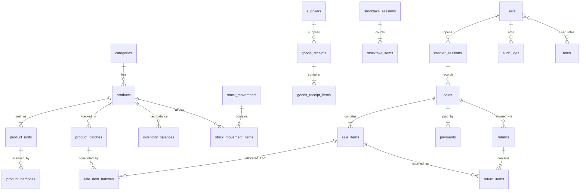

# DATABASE — SembakoOS

Spesifikasi struktur data, relasi, indeks, constraint, dan aturan penyimpanan.

| Atribut | Nilai |
| --- | --- |
| Versi dokumen | 1.0 |
| Tanggal | 24 Oktober 2026 |
| Mengacu ke | `PRD.md` v1.1 (BR-01 s.d. BR-29, FR-*), `ARCHITECTURE.md` |
| `schema_version` saat ini | **1** |
| Mesin penyimpanan MVP | IndexedDB melalui **Dexie** (di perangkat kasir) |
| Model acuan | Skema **relasional logis**; dapat dipetakan 1:1 ke SQLite/PostgreSQL bila kelak dibutuhkan |

> **Catatan penting:** IndexedDB tidak memiliki `CHECK`, `FOREIGN KEY`, maupun `UNIQUE` lintas tabel seperti SQL. Constraint di dokumen ini ditulis secara logis, lalu **ditegakkan di dua tempat**: (1) indeks unik Dexie bila memungkinkan, (2) lapisan repository/domain di dalam transaksi yang sama. Constraint yang tidak bisa dijaga oleh mesin wajib punya tes (lihat `TESTING.md`).

---

## Daftar Isi

1. [Prinsip dan Konvensi](#1-prinsip-dan-konvensi)
2. [Diagram Relasi](#2-diagram-relasi)
3. [Definisi Tabel](#3-definisi-tabel)
4. [Indeks dan Deklarasi Dexie](#4-indeks-dan-deklarasi-dexie)
5. [Invarian dan Constraint](#5-invarian-dan-constraint)
6. [Unit Transaksi Atomik](#6-unit-transaksi-atomik)
7. [Penomoran dan Counter](#7-penomoran-dan-counter)
8. [Migrasi Skema](#8-migrasi-skema)
9. [Data Referensi dan Seed](#9-data-referensi-dan-seed)
10. [Format Berkas Backup](#10-format-berkas-backup)
11. [Retensi Data](#11-retensi-data)
12. [Contoh Kueri Laporan](#12-contoh-kueri-laporan)

---

## 1. Prinsip dan Konvensi

### 1.1 Tipe dasar

| Konsep | Tipe | Aturan |
| --- | --- | --- |
| **ID** | `TEXT` (UUID v7) | Dibuat di sisi klien; urut waktu; tahan bentrok (BR-07). Dilarang auto-increment. |
| **Uang** | `INTEGER` | Rupiah bulat (BR-06). Dilarang `float`. |
| **Biaya per satuan dasar** | `INTEGER` dengan akhiran `_x10k` | Rupiah × 10.000 per satuan dasar. Contoh: Rp 12,5/gram = `125000`. Menghindari kehilangan presisi pada barang curah. |
| **Kuantitas** | `INTEGER` dengan akhiran `_base` | Dalam **satuan dasar terkecil** (pcs, gram, mililiter). 0,75 kg = `750` g. Dilarang `float` (BR-13, BR-25). |
| **Waktu kejadian** | `INTEGER` | Epoch milidetik UTC, akhiran `_at`. Ditampilkan dalam zona waktu toko (BR-08). |
| **Tanggal kalender** | `TEXT` `YYYY-MM-DD` | Akhiran `_date`. Dipakai untuk kedaluwarsa dan tanggal penerimaan. Tanpa zona waktu. |
| **Boolean** | `INTEGER` 0/1 | IndexedDB tidak dapat mengindeks nilai boolean; semua flag disimpan sebagai 0/1. |
| **Enum** | `TEXT` | Nilai dibatasi daftar di dokumen ini; divalidasi dengan Zod. |
| **JSON** | `TEXT` (string JSON) | Hanya untuk audit (`before_json`/`after_json`), setting, dan payload draf. |

### 1.2 Kolom standar

Kecuali tabel yang ditandai *append-only*, setiap tabel entitas memiliki:

| Kolom | Tipe | Keterangan |
| --- | --- | --- |
| `id` | TEXT | PK |
| `created_at` | INTEGER | Waktu pembuatan |
| `created_by` | TEXT | `users.id` |
| `updated_at` | INTEGER | Waktu perubahan terakhir |
| `updated_by` | TEXT | `users.id` |
| `row_version` | INTEGER | Mulai 1, bertambah setiap perubahan. Dipakai untuk deteksi konflik bila sinkronisasi ditambahkan. |

Pada tabel dokumen (penjualan, penerimaan, dll.), `created_by`/`updated_by` merujuk pengguna yang melakukannya.

### 1.3 Konvensi lain

- Nama tabel dan kolom: `snake_case`, jamak untuk tabel.
- **Tanda delta stok:** positif = masuk, negatif = keluar. Satu standar di seluruh sistem.
- **Penghapusan:** tidak ada penghapusan fisik untuk data yang sudah dirujuk. Gunakan `active = 0` dan/atau `archived_at`.
- **Append-only / immutable:** `stock_movements`, `stock_movement_items`, `audit_logs`, `price_history`, `sale_items`, `sale_item_batches`, `payments`, `return_items`. Tabel dokumen (`sales`, `goods_receipts`, `stocktake_sessions`, `returns`) hanya boleh berubah **status** menurut diagram status, bukan isinya, setelah diposting (BR-27).
- **Snapshot:** nama, harga, satuan, dan biaya disalin ke baris transaksi (BR-05).
- **Skala satuan dasar:**

| `base_unit_kind` | Satuan dasar | Tampilan | Contoh konversi |
| --- | --- | --- | --- |
| `count` | `pcs` | pcs, pack, karton | 1 karton = 40 pcs |
| `weight` | `g` | g, ons, kg | 1 kg = 1000 g; 1 ons = 100 g |
| `volume` | `ml` | ml, l | 1 l = 1000 ml |

---

## 2. Diagram Relasi



Hubungan "dokumen → stok" bersifat tidak langsung: dokumen (`sales`, `goods_receipts`, `returns`, `stocktake_sessions`) memiliki satu atau lebih `stock_movements` melalui `ref_type` + `ref_id`.

---

## 3. Definisi Tabel

Notasi kolom: `NN` = wajib, `UQ` = unik, `FK` = merujuk tabel lain, `—` = opsional.

### 3.1 Pengguna dan Akses

**`users`**

| Kolom | Tipe | Aturan |
| --- | --- | --- |
| id | TEXT | PK |
| name | TEXT | NN |
| pin_hash | TEXT | NN, hasil KDF (base64). Dilarang menyimpan PIN asli. |
| pin_salt | TEXT | NN, acak per pengguna |
| pin_kdf | TEXT | NN, mis. `pbkdf2-sha256` |
| pin_iterations | INTEGER | NN, jumlah iterasi yang dipakai (agar dapat ditingkatkan di masa depan) |
| status | TEXT | NN: `active` \| `disabled` |
| failed_attempts | INTEGER | NN, bawaan 0 |
| locked_until | INTEGER | — , epoch ms; kosong bila tidak terkunci |
| last_login_at | INTEGER | — |
| + kolom standar | | |

**`roles`** *(data referensi, di-seed)*

| Kolom | Tipe | Aturan |
| --- | --- | --- |
| id | TEXT | PK |
| code | TEXT | NN UQ: `owner` \| `supervisor` \| `cashier` \| `stock_clerk` |
| name | TEXT | NN |

**`user_roles`**

| Kolom | Tipe | Aturan |
| --- | --- | --- |
| user_id | TEXT | FK users, NN |
| role_id | TEXT | FK roles, NN |
| PK | | (`user_id`, `role_id`) |

> Izin per peran (matriks `PRD.md` §5.2) didefinisikan **di kode** sebagai peta tetap `role → permission[]`, bukan di tabel, agar tidak dapat diubah lewat data. Angka ambang (batas diskon, ambang penyesuaian) berada di `app_settings`.

**`approvals`** *(append-only)*

| Kolom | Tipe | Aturan |
| --- | --- | --- |
| id | TEXT | PK |
| action | TEXT | NN, mis. `sale.discount_over_limit`, `sale.void`, `stock.adjustment_over_threshold` |
| entity_type / entity_id | TEXT | — , objek yang disetujui |
| requested_by | TEXT | FK users, NN |
| approved_by | TEXT | FK users, NN (harus berperan Supervisor/Owner) |
| reason | TEXT | — |
| created_at | INTEGER | NN |

### 3.2 Katalog

**`categories`**: `id`, `name` NN, `parent_id` — , `sort_order` NN (0), `active` NN (1) + kolom standar.

**`units`** *(data referensi, di-seed)*: `id`, `code` NN UQ (`pcs`, `pack`, `karton`, `g`, `ons`, `kg`, `ml`, `l`), `name` NN, `kind` NN (`count` \| `weight` \| `volume`).

**`products`**

| Kolom | Tipe | Aturan |
| --- | --- | --- |
| id | TEXT | PK |
| name | TEXT | NN |
| sku | TEXT | — , UQ bila terisi. Disimpan `undefined` (bukan string kosong) bila kosong agar indeks unik tidak bentrok. |
| category_id | TEXT | FK categories, NN |
| base_unit_kind | TEXT | NN: `count` \| `weight` \| `volume` |
| base_unit_code | TEXT | NN: `pcs` \| `g` \| `ml` |
| min_stock_base | INTEGER | NN, ≥ 0, bawaan 0 |
| track_expiry | INTEGER | NN, 0/1 |
| avg_cost_x10k | INTEGER | NN, ≥ 0 (weighted average per satuan dasar, BR-26) |
| last_cost_x10k | INTEGER | NN, ≥ 0 |
| active | INTEGER | NN, 0/1 |
| archived_at | INTEGER | — |
| note | TEXT | — |
| + kolom standar | | |

**`product_units`** *(satuan jual dan harga)*

| Kolom | Tipe | Aturan |
| --- | --- | --- |
| id | TEXT | PK |
| product_id | TEXT | FK products, NN |
| unit_code | TEXT | FK units, NN. UQ bersama `product_id` |
| factor_to_base | INTEGER | NN, ≥ 1 (mis. kg→g = 1000) |
| sale_price | INTEGER | NN, ≥ 0, harga **per satuan jual ini** |
| is_default | INTEGER | NN, 0/1; tepat satu default aktif per produk |
| active | INTEGER | NN, 0/1 |
| + kolom standar | | |

**`product_barcodes`**

| Kolom | Tipe | Aturan |
| --- | --- | --- |
| id | TEXT | PK |
| product_id | TEXT | FK products, NN |
| product_unit_id | TEXT | FK product_units, NN (barcode menentukan satuan jual yang terpilih saat scan) |
| barcode | TEXT | NN **UQ** (FR-CAT-03) |
| kind | TEXT | NN: `manufacturer` \| `internal` |
| created_at / created_by | | NN |

**`price_history`** *(append-only)*: `id`, `product_unit_id` NN, `field` NN (`sale_price` \| `last_cost`), `old_value` NN, `new_value` NN, `reason` —, `changed_by` NN, `changed_at` NN. (FR-CAT-09)

### 3.3 Pemasok dan Batch

**`suppliers`**: `id`, `name` NN, `contact` —, `address` —, `notes` —, `active` NN (1), `archived_at` — + kolom standar.

**`product_batches`**

| Kolom | Tipe | Aturan |
| --- | --- | --- |
| id | TEXT | PK |
| product_id | TEXT | FK products, NN; produk harus `track_expiry = 1` |
| batch_code | TEXT | — |
| expiry_date | TEXT | NN, `YYYY-MM-DD` (BR-08) |
| unit_cost_x10k | INTEGER | NN, biaya batch per satuan dasar |
| received_at | INTEGER | NN |
| receipt_item_id | TEXT | — , FK goods_receipt_items; kosong untuk saldo awal |
| active | INTEGER | NN, 0/1 (0 bila sudah habis dan diarsipkan) |
| + kolom standar | | |

Unik logis: (`product_id`, `batch_code`, `expiry_date`). Penerimaan dengan kombinasi yang sama **menambah** batch yang ada, bukan membuat batch baru.

### 3.4 Inventaris

**`inventory_balances`** *(saldo turunan, diperbarui dalam transaksi yang sama dengan movement)*

| Kolom | Tipe | Aturan |
| --- | --- | --- |
| product_id | TEXT | FK products, NN |
| batch_id | TEXT | NN; berisi string kosong `''` bila produk tidak dilacak kedaluwarsa (IndexedDB tidak mengizinkan `null` pada kunci majemuk) |
| qty_base | INTEGER | NN; ≥ 0 kecuali stok negatif diaktifkan (BR-10) |
| updated_at | INTEGER | NN |
| PK | | (`product_id`, `batch_id`) |

Stok produk = Σ `qty_base` seluruh baris produk tersebut.

**`stock_movements`** *(append-only; header)*

| Kolom | Tipe | Aturan |
| --- | --- | --- |
| id | TEXT | PK |
| type | TEXT | NN, lihat enum di bawah |
| occurred_at | INTEGER | NN |
| user_id | TEXT | FK users, NN |
| session_id | TEXT | — , FK cashier_sessions |
| ref_type | TEXT | NN: `sale` \| `receipt` \| `return` \| `stocktake` \| `adjustment` \| `opening` \| `reversal` |
| ref_id | TEXT | — , id dokumen sumber |
| reverses_movement_id | TEXT | — , diisi untuk reversal |
| reason_code | TEXT | — |
| note | TEXT | — |

Enum `type`:

| Nilai | Arti | Tanda delta |
| --- | --- | --- |
| `OPENING_BALANCE` | Saldo awal | + |
| `RECEIPT` | Penerimaan barang diposting | + |
| `SALE` | Penjualan | − |
| `VOID_REVERSAL` | Pembalikan karena void | + |
| `RETURN_RESTOCK` | Retur layak jual masuk stok | + |
| `RETURN_DAMAGED` | Retur rusak/kedaluwarsa (dua baris item: + lalu −, net 0) | + dan − |
| `ADJUSTMENT_DAMAGED` | Barang rusak | − |
| `ADJUSTMENT_EXPIRED` | Barang kedaluwarsa dibuang | − |
| `ADJUSTMENT_LOST` | Barang hilang | − |
| `ADJUSTMENT_OTHER` | Koreksi lain | + / − |
| `STOCKTAKE_ADJUSTMENT` | Hasil stok opname diposting | + / − |
| `REVERSAL` | Pembalikan generik (mis. penerimaan salah) | berlawanan dengan asal |

**`stock_movement_items`** *(append-only)*

| Kolom | Tipe | Aturan |
| --- | --- | --- |
| id | TEXT | PK |
| movement_id | TEXT | FK stock_movements, NN |
| product_id | TEXT | FK products, NN |
| batch_id | TEXT | — (kosong bila produk tidak dilacak) |
| qty_delta_base | INTEGER | NN, ≠ 0 |
| unit_cost_x10k | INTEGER | NN, snapshot biaya per satuan dasar saat itu |
| occurred_at | INTEGER | NN, **salinan** waktu header (denormalisasi tak berubah) agar kartu stok per produk dapat diurutkan lewat satu indeks |

### 3.5 Penjualan

**`sales`**

| Kolom | Tipe | Aturan |
| --- | --- | --- |
| id | TEXT | PK. **Dibuat saat keranjang dibuka dan menjadi kunci idempotensi** (FR-POS-08). Menyimpan ulang id yang sama ditolak. |
| receipt_no | TEXT | NN **UQ** |
| session_id | TEXT | FK cashier_sessions, NN |
| cashier_id | TEXT | FK users, NN |
| status | TEXT | NN: `completed` \| `voided` \| `partially_returned` \| `fully_returned` |
| subtotal | INTEGER | NN, Σ line_total |
| discount_total | INTEGER | NN, ≥ 0 (diskon tingkat transaksi) |
| tax_total | INTEGER | NN, bawaan 0 |
| rounding_adjustment | INTEGER | NN, bawaan 0 (P2) |
| total | INTEGER | NN = subtotal − discount_total + tax_total + rounding_adjustment |
| completed_at | INTEGER | NN |
| voided_at / voided_by / void_reason | | — , diisi saat void |
| approval_id | TEXT | — , bila ada Approval |
| + kolom standar | | |

**`sale_items`** *(append-only)*

| Kolom | Tipe | Aturan |
| --- | --- | --- |
| id | TEXT | PK |
| sale_id | TEXT | FK sales, NN |
| line_no | INTEGER | NN |
| product_id | TEXT | FK products, NN |
| product_unit_id | TEXT | FK product_units, NN |
| name_snapshot | TEXT | NN |
| unit_code_snapshot | TEXT | NN |
| factor_snapshot | INTEGER | NN, faktor konversi saat itu |
| barcode_snapshot | TEXT | — |
| qty_base | INTEGER | NN, > 0 |
| unit_price_snapshot | INTEGER | NN, harga per satuan jual saat itu |
| discount | INTEGER | NN, ≥ 0, diskon baris |
| line_total | INTEGER | NN, = round_half_up(qty_base × unit_price_snapshot ÷ factor_snapshot) − discount (BR-14) |
| unit_cost_x10k_snapshot | INTEGER | NN, harga pokok rata-rata saat itu per satuan dasar |

**`sale_item_batches`** *(append-only; hanya produk dilacak kedaluwarsa)*: `sale_item_id` NN, `batch_id` NN, `qty_base` NN > 0. PK (`sale_item_id`, `batch_id`).

**`payments`** *(append-only)*

| Kolom | Tipe | Aturan |
| --- | --- | --- |
| id | TEXT | PK |
| sale_id | TEXT | FK sales, NN |
| method | TEXT | NN: `cash` \| `transfer_manual` \| `qris_manual` |
| amount_received | INTEGER | NN |
| change_amount | INTEGER | NN, ≥ 0 |
| amount_applied | INTEGER | NN = amount_received − change_amount |
| reference | TEXT | — , catatan referensi non-tunai |
| created_at | INTEGER | NN |

**`returns`**

| Kolom | Tipe | Aturan |
| --- | --- | --- |
| id | TEXT | PK |
| return_no | TEXT | NN **UQ** |
| original_sale_id | TEXT | FK sales, NN |
| session_id | TEXT | FK cashier_sessions, NN |
| reason | TEXT | NN |
| refund_amount | INTEGER | NN, ≥ 0 |
| refund_method | TEXT | NN: `cash` \| `transfer_manual` \| `qris_manual` |
| approval_id | TEXT | — |
| created_at | INTEGER | NN |
| + `created_by` | | NN |

**`return_items`** *(append-only)*: `id`, `return_id` NN, `sale_item_id` NN, `qty_base` NN > 0, `condition` NN (`resellable` \| `damaged` \| `expired`), `refund_amount` NN, `restocked` NN (0/1).

**`cashier_sessions`**

| Kolom | Tipe | Aturan |
| --- | --- | --- |
| id | TEXT | PK |
| user_id | TEXT | FK users, NN |
| device_id | TEXT | NN |
| status | TEXT | NN: `open` \| `closed` |
| opening_cash | INTEGER | NN, ≥ 0 |
| closing_cash | INTEGER | — , terisi saat tutup |
| expected_cash | INTEGER | — , dihitung saat tutup (BR-22) |
| variance | INTEGER | — , closing_cash − expected_cash |
| variance_note | TEXT | — ; **wajib bila variance ≠ 0** |
| opened_at | INTEGER | NN |
| closed_at | INTEGER | — |

**`held_carts`** *(sementara; FR-POS-16)*: `id`, `user_id` NN, `session_id` NN, `payload_json` NN, `created_at` NN, `updated_at` NN. Dihapus saat dilanjutkan atau dibatalkan. Bukan catatan bisnis permanen.

### 3.6 Penerimaan Barang

**`goods_receipts`**

| Kolom | Tipe | Aturan |
| --- | --- | --- |
| id | TEXT | PK |
| receipt_no | TEXT | NN **UQ** |
| supplier_id | TEXT | FK suppliers, NN |
| supplier_ref_no | TEXT | — , nomor faktur/surat jalan |
| received_date | TEXT | NN, `YYYY-MM-DD` |
| status | TEXT | NN: `draft` \| `posted` \| `reversed` |
| total_cost | INTEGER | NN |
| note | TEXT | — |
| posted_at / posted_by | | — , diisi saat posting |
| + kolom standar | | |

**`goods_receipt_items`**: `id`, `receipt_id` NN, `product_id` NN, `product_unit_id` NN, `qty_base` NN > 0, `unit_cost_x10k` NN, `discount` NN (0), `batch_code` —, `expiry_date` — (wajib bila produk dilacak), `batch_id` — (diisi saat posting).

### 3.7 Stok Opname

**`stocktake_sessions`**: `id`, `name` NN, `scope_type` NN (`all` \| `category` \| `selected`), `scope_ref` —, `status` NN (`counting` \| `review` \| `posted` \| `cancelled`), `blind` NN (0/1), `reviewed_by` —, `posted_at` — + kolom standar.

**`stocktake_items`**

| Kolom | Tipe | Aturan |
| --- | --- | --- |
| id | TEXT | PK |
| session_id | TEXT | FK stocktake_sessions, NN |
| product_id | TEXT | FK products, NN |
| batch_id | TEXT | — |
| system_qty_snapshot | INTEGER | — , saldo sistem **saat item dihitung** (BR-24) |
| counted_qty | INTEGER | — , hasil hitung fisik |
| counted_at / counted_by | | — |
| variance | INTEGER | — , counted_qty − system_qty_snapshot |
| approved | INTEGER | — , 0/1 hasil review |
| note | TEXT | — |

### 3.8 Audit, Pengaturan, dan Pendukung

**`audit_logs`** *(append-only)*

| Kolom | Tipe | Aturan |
| --- | --- | --- |
| id | TEXT | PK |
| occurred_at | INTEGER | NN |
| user_id | TEXT | NN (aktor) |
| device_id | TEXT | NN |
| action | TEXT | NN, mis. `price.change`, `stock.adjust`, `sale.void`, `sale.return`, `approval.grant`, `user.role_change`, `auth.lockout`, `backup.restore`, `settings.change` |
| entity_type / entity_id | TEXT | — |
| before_json / after_json | TEXT | — , **tanpa data rahasia** (tidak boleh memuat PIN atau hash) |
| reason | TEXT | — |
| ref | TEXT | — , referensi dokumen |

**`app_settings`**: `key` PK, `value_json` NN, `updated_at` NN, `updated_by` NN. Kunci awal: `store.profile`, `receipt.layout`, `policy.negative_stock` (bawaan `false`), `policy.discount_limits`, `policy.return_days`, `policy.adjustment_threshold`, `policy.expiry_alert_days`, `security.pin_min_length`, `security.autolock_minutes`, `device.id`, `device.code`, `locale.timezone`.

**`backup_history`**: `id`, `file_name` NN, `created_at` NN, `status` NN (`success` \| `failed`), `checksum_sha256` —, `size_bytes` —, `schema_version` NN, `app_version` NN, `error` —.

**`counters`**: `key` PK, `value` INTEGER NN. Untuk nomor urut (lihat 7).

**`sync_outbox`** *(P2, tidak dibuat di MVP kecuali sync diaktifkan)*: `id`, `event_type` NN, `payload_json` NN, `status` NN (`pending` \| `sent` \| `failed`), `retry_count` NN, `created_at` NN.

---

## 4. Indeks dan Deklarasi Dexie

Prinsip indeks: hanya untuk kueri yang benar-benar dipakai (pencarian barcode, kartu stok, laporan per tanggal, daftar status). Indeks berlebih memperlambat penulisan di tablet.

```ts
// src/data/db.ts — schema_version 1
db.version(1).stores({
  users:                 'id, status',
  roles:                 'id, &code',
  user_roles:            '[user_id+role_id], user_id, role_id',
  approvals:             'id, entity_type, entity_id, created_at',

  categories:            'id, name, parent_id, active',
  units:                 'id, &code',
  products:              'id, name, &sku, category_id, active, track_expiry',
  product_units:         'id, product_id, &[product_id+unit_code]',
  product_barcodes:      'id, &barcode, product_id, product_unit_id',
  price_history:         'id, product_unit_id, changed_at',

  suppliers:             'id, name, active',
  product_batches:       'id, product_id, expiry_date, [product_id+expiry_date], active',

  inventory_balances:    '[product_id+batch_id], product_id',
  stock_movements:       'id, type, occurred_at, [ref_type+ref_id], user_id',
  stock_movement_items:  'id, movement_id, product_id, [product_id+occurred_at]',

  sales:                 'id, &receipt_no, session_id, cashier_id, status, completed_at',
  sale_items:            'id, sale_id, product_id',
  sale_item_batches:     '[sale_item_id+batch_id], batch_id',
  payments:              'id, sale_id, method',
  returns:               'id, &return_no, original_sale_id, created_at',
  return_items:          'id, return_id, sale_item_id',
  cashier_sessions:      'id, user_id, status, opened_at',
  held_carts:            'id, user_id, updated_at',

  goods_receipts:        'id, &receipt_no, supplier_id, status, received_date',
  goods_receipt_items:   'id, receipt_id, product_id',
  stocktake_sessions:    'id, status, created_at',
  stocktake_items:       'id, session_id, [session_id+product_id]',

  audit_logs:            'id, occurred_at, user_id, action, [entity_type+entity_id]',
  app_settings:          'key',
  backup_history:        'id, created_at',
  counters:              'key',
});
```

Catatan teknis:
- Awalan `&` = indeks unik. `&sku` aman dengan SKU kosong **hanya bila nilainya `undefined`** (record tanpa kunci tidak diindeks).
- Indeks majemuk dengan `batch_id` memakai string kosong, bukan `null`.
- Pencarian **nama** produk tidak memakai indeks Dexie (tidak ada full-text); lihat `ARCHITECTURE.md` §11 (indeks pencarian di memori).
- Perubahan indeks = versi skema baru + migrasi (lihat 8).

---

## 5. Invarian dan Constraint

Berikut aturan yang **harus selalu benar**. Setiap invarian punya uji otomatis (`TESTING.md` §7) dan pemeriksa konsistensi (FR-INV-10).

### 5.1 Invarian data

| ID | Invarian | Penegak |
| --- | --- | --- |
| DB-01 | Untuk setiap (`product_id`, `batch_id`): `qty_base` = Σ `qty_delta_base` pada `stock_movement_items` | Transaksi + pemeriksa konsistensi |
| DB-02 | `sales.total` = `subtotal` − `discount_total` + `tax_total` + `rounding_adjustment`; `subtotal` = Σ `sale_items.line_total` | Domain + tes |
| DB-03 | Untuk `sale_item` produk dilacak: Σ `sale_item_batches.qty_base` = `sale_items.qty_base` | Domain + tes |
| DB-04 | Penjualan tunai: `payments.amount_applied` = `sales.total`, `amount_received` ≥ `total`, `change_amount` = `amount_received` − `total` | Domain + tes |
| DB-05 | `cashier_sessions.expected_cash` = `opening_cash` + Σ(amount_received − change) tunai − refund tunai (BR-22); `variance_note` wajib bila `variance` ≠ 0 | Domain + tes |
| DB-06 | `inventory_balances.qty_base` ≥ 0 kecuali `policy.negative_stock = true` (BR-10) | Domain di dalam transaksi |
| DB-07 | Σ `return_items.qty_base` per `sale_item` ≤ `sale_items.qty_base` (BR-18) | Domain di dalam transaksi |
| DB-08 | `product_barcodes.barcode` unik; `products.sku` unik bila terisi | Indeks unik Dexie |
| DB-09 | `sales.receipt_no`, `returns.return_no`, `goods_receipts.receipt_no` unik | Indeks unik Dexie |
| DB-10 | `sales.id` yang sudah ada tidak dapat disimpan ulang (idempotensi) | Kunci primer + penanganan galat |
| DB-11 | Setiap aksi pada daftar sensitif memiliki satu `audit_logs` dengan transaksi yang sama | Domain + tes |
| DB-12 | Tidak ada `stock_movement_items` tanpa header, dan tidak ada movement tanpa minimal satu item | Domain + tes |
| DB-13 | Tepat satu `cashier_sessions` berstatus `open` per perangkat (MVP) | Domain + tes |
| DB-14 | Produk `track_expiry = 1` hanya memiliki saldo pada `batch_id` ≠ `''` | Domain + tes |
| DB-15 | Baris pada tabel append-only tidak pernah diperbarui atau dihapus lewat repository | Repository tidak menyediakan `update/delete` untuk tabel ini; tes |
| DB-16 | `product_units`: tepat satu `is_default = 1` aktif per produk; `factor_to_base` ≥ 1 | Domain |
| DB-17 | Penjualan hanya merujuk produk `active = 1` dan batch tidak kedaluwarsa pada `completed_at` | Domain |

### 5.2 Diagram status dokumen

| Dokumen | Transisi yang diizinkan |
| --- | --- |
| `sales.status` | `completed` → `voided`; `completed` → `partially_returned` → `fully_returned`; `completed` → `fully_returned`. Tidak ada transisi balik. |
| `goods_receipts.status` | `draft` → `posted` → `reversed`. `draft` dapat dihapus (belum berdampak ke stok). |
| `stocktake_sessions.status` | `counting` → `review` → `posted`; `counting`/`review` → `cancelled`. |
| `cashier_sessions.status` | `open` → `closed`. |
| `users.status` | `active` ↔ `disabled`. |

---

## 6. Unit Transaksi Atomik

Setiap baris di bawah dijalankan dalam **satu transaksi Dexie `rw`** yang mencakup semua tabel terdaftar. Jika satu langkah melempar galat, **seluruh** transaksi dibatalkan dan tidak ada status sukses yang ditampilkan.

| Use case | Tabel yang ditulis dalam satu transaksi | Pemeriksaan di dalam transaksi |
| --- | --- | --- |
| **Checkout (penjualan)** | `counters`, `sales`, `sale_items`, `sale_item_batches`, `payments`, `stock_movements`, `stock_movement_items`, `inventory_balances`, `audit_logs` (bila ada Approval/diskon di atas batas), `approvals`, hapus `held_carts` terkait | Sesi kas terbuka; `sales.id` belum ada; produk aktif; stok cukup (baca saldo **di dalam** transaksi); batch tidak kedaluwarsa; alokasi FEFO; total & kembalian benar |
| **Void** | `sales`, `stock_movements`, `stock_movement_items`, `inventory_balances`, `audit_logs`, `approvals` | Status `completed`; sesi kas sama (BR-17) atau izin; alasan terisi |
| **Retur** | `counters`, `returns`, `return_items`, `sales` (status), `stock_movements`, `stock_movement_items`, `inventory_balances`, `audit_logs`, `approvals` | Kuantitas ≤ sisa yang dapat diretur; batas hari retur; kondisi barang menentukan restock |
| **Posting penerimaan** | `goods_receipts` (status), `goods_receipt_items` (batch_id), `product_batches`, `stock_movements`, `stock_movement_items`, `inventory_balances`, `products` (`avg_cost_x10k`, `last_cost_x10k`), `price_history`, `audit_logs` | Status `draft`; expiry wajib untuk produk dilacak; hitung weighted average (BR-26) |
| **Reversal penerimaan** | `goods_receipts`, `stock_movements`, `stock_movement_items`, `inventory_balances`, `audit_logs` | Saldo tidak menjadi negatif; alasan terisi |
| **Penyesuaian stok** | `stock_movements`, `stock_movement_items`, `inventory_balances`, `audit_logs`, `approvals` | Jenis + alasan terisi; ambang Approval; saldo tidak negatif |
| **Posting stok opname** | `stocktake_sessions`, `stocktake_items`, `stock_movements`, `stock_movement_items`, `inventory_balances`, `audit_logs` | Status `review`; penyesuaian = `counted_qty` − `system_qty_snapshot` diterapkan ke saldo terkini (BR-24) |
| **Tutup sesi kas** | `cashier_sessions`, `audit_logs` (bila selisih) | Hitung `expected_cash`; `variance_note` wajib bila selisih ≠ 0 |
| **Ubah harga** | `product_units`, `price_history`, `audit_logs` | Izin; nilai valid |
| **Restore** | Seluruh database (lihat `ARCHITECTURE.md` §15) | Validasi berkas, versi skema, checksum; backup pengaman dibuat lebih dulu |

Aturan pelaksanaan:
1. **Baca-ubah-tulis saldo wajib terjadi di dalam transaksi yang sama.** Dilarang membaca saldo di luar transaksi lalu menulis di dalam (celah pada dua tab/peramban).
2. Transaksi tidak boleh memanggil `await` pada operasi non-IndexedDB (jaringan, timer) karena transaksi IndexedDB akan otomatis selesai.
3. Efek samping non-data (cetak struk, bunyi) dilakukan **setelah** transaksi berhasil.

---

## 7. Penomoran dan Counter

| Dokumen | Format [USULAN] | Kunci `counters` |
| --- | --- | --- |
| Struk penjualan | `{KODE}-{YYYYMMDD}-{NNNN}` (mis. `TAB1-20261024-0007`) | `sale:{KODE}:{YYYYMMDD}` |
| Retur | `RTN-{KODE}-{YYYYMMDD}-{NNNN}` | `return:{KODE}:{YYYYMMDD}` |
| Penerimaan barang | `GR-{KODE}-{YYYYMMDD}-{NNNN}` | `receipt:{KODE}:{YYYYMMDD}` |

- `KODE` = `app_settings['device.code']` (kode perangkat 2–5 karakter) agar tidak bentrok bila kelak ada lebih dari satu perangkat.
- `YYYYMMDD` memakai tanggal **zona waktu toko**.
- Penambahan counter dilakukan **di dalam** transaksi dokumen sehingga tidak ada nomor ganda dan tidak ada celah nomor akibat transaksi yang dibatalkan.
- Nomor tidak pernah dipakai ulang, termasuk untuk transaksi void.

---

## 8. Migrasi Skema

1. Setiap perubahan skema = `db.version(n+1)` baru. **Versi lama tidak boleh diedit.**
2. Migrasi berisi `upgrade(tx)` yang idempoten dan dapat diuji dengan basis data fixture versi sebelumnya.
3. **Sebelum migrasi** yang mengubah data, aplikasi membuat backup otomatis ke berkas dan hanya melanjutkan jika backup lolos validasi.
4. Migrasi **destruktif** (menghapus tabel/kolom, mengubah makna data) membutuhkan persetujuan tertulis pemilik proyek dan entri `CHANGELOG.md` (lihat `AGENTS.md`).
5. `schema_version` ditulis ke setiap backup; restore menolak berkas bersekema lebih baru dari aplikasi.
6. Kompatibilitas ke depan: kolom baru dibuat opsional atau berbawaan agar data lama tetap valid.
7. Tabel `sync_outbox` dan kolom `row_version` sudah tersedia/terencana agar penambahan sinkronisasi tidak memaksa penulisan ulang data.

---

## 9. Data Referensi dan Seed

| Data | Sumber | Catatan |
| --- | --- | --- |
| `roles` | Seed bawaan aplikasi | 4 peran |
| `units` | Seed bawaan aplikasi | `pcs, pack, karton, g, ons, kg, ml, l` |
| `app_settings` | Dibuat saat setup awal (FR-SET-01) | Kebijakan bawaan sesuai `PRD.md` |
| Akun Owner | Dibuat pengguna saat setup awal | Tidak ada akun bawaan |
| **Data demo** | Hanya lewat perintah pengembangan (`pnpm seed:demo`) | **Tidak pernah** ada di build produksi; ditandai jelas, dipisah dari data nyata (lihat `AGENTS.md`) |

---

## 10. Format Berkas Backup

Berkas `.sembako-backup.json` (opsional dikompresi `.gz`):

```json
{
  "meta": {
    "format": "sembako-backup",
    "format_version": 1,
    "schema_version": 1,
    "app_version": "0.1.0",
    "device_id": "…",
    "created_at": 1792852373449,
    "tables": { "products": 523, "sales": 8124, "…": 0 },
    "checksum_sha256": "…"
  },
  "data": {
    "products": [ … ],
    "sales": [ … ]
  }
}
```

- Checksum dihitung atas serialisasi kanonik `data` (kunci terurut).
- Validasi restore: struktur JSON → `format` dan `format_version` → `schema_version` ≤ aplikasi → checksum → jumlah baris per tabel cocok dengan `meta.tables` → pemeriksaan invarian DB-01 dan DB-02 pada contoh/seluruh data.
- Backup tidak memuat `pin_hash` secara terbuka jika enkripsi backup diaktifkan (P1, FR-BKP). Bila tidak dienkripsi, berkas diperlakukan sebagai data sensitif dan pengguna diperingatkan.
- Ekspor CSV bukan backup (FR-BKP-06).

---

## 11. Retensi Data

| Data | Kebijakan MVP [USULAN] |
| --- | --- |
| Transaksi, movement, audit | Disimpan tanpa batas di perangkat; arsip ke berkas dapat ditambahkan pasca-MVP |
| `held_carts` | Dihapus saat dilanjutkan/dibatalkan, dan kedaluwarsa otomatis setelah 24 jam |
| `backup_history` | Simpan 100 entri terakhir (berkas backup sendiri tidak dikelola aplikasi) |
| Draft penerimaan/opname dibatalkan | Dapat dihapus pengguna; tidak berdampak ke stok |
| Data pengguna nonaktif | Tetap disimpan untuk keterlacakan audit |

Batas penyimpanan browser dipantau (`navigator.storage.estimate`) dan peringatan ditampilkan saat pemakaian tinggi (FR-SET-05; lihat `ARCHITECTURE.md` §8).

---

## 12. Contoh Kueri Laporan

Dalam SQL acuan (pada Dexie diimplementasikan lewat repository dengan agregasi di kode).

**Stok saat ini per produk**
```sql
SELECT p.id, p.name, COALESCE(SUM(b.qty_base), 0) AS stok_base
FROM products p
LEFT JOIN inventory_balances b ON b.product_id = p.id
WHERE p.active = 1
GROUP BY p.id;
```

**Omzet bersih harian (zona waktu toko)**
```sql
-- :from_ms, :to_ms = batas hari toko dalam epoch ms UTC (inklusif/eksklusif)
SELECT date(s.completed_at/1000 + :tz_offset_sec, 'unixepoch') AS hari,
       COUNT(*) AS jumlah_transaksi,
       SUM(s.total) AS omzet_kotor
FROM sales s
WHERE s.status IN ('completed','partially_returned','fully_returned')
  AND s.completed_at >= :from_ms AND s.completed_at < :to_ms
GROUP BY hari;
-- Omzet bersih = omzet_kotor − Σ returns.refund_amount pada periode (definisi PRD §7.7)
```

**Batch hampir kedaluwarsa**
```sql
SELECT pb.*, p.name, SUM(ib.qty_base) AS sisa_base
FROM product_batches pb
JOIN products p ON p.id = pb.product_id
JOIN inventory_balances ib ON ib.batch_id = pb.id
WHERE pb.active = 1 AND ib.qty_base > 0
  AND pb.expiry_date <= date(:today, '+30 days')
GROUP BY pb.id
ORDER BY pb.expiry_date;
```

**Pemeriksa konsistensi saldo (DB-01)**
```sql
SELECT ib.product_id, ib.batch_id, ib.qty_base AS saldo,
       COALESCE(SUM(i.qty_delta_base), 0) AS dari_ledger
FROM inventory_balances ib
LEFT JOIN stock_movement_items i
  ON i.product_id = ib.product_id AND COALESCE(i.batch_id,'') = ib.batch_id
GROUP BY ib.product_id, ib.batch_id
HAVING saldo <> dari_ledger;   -- hasil harus kosong
```
