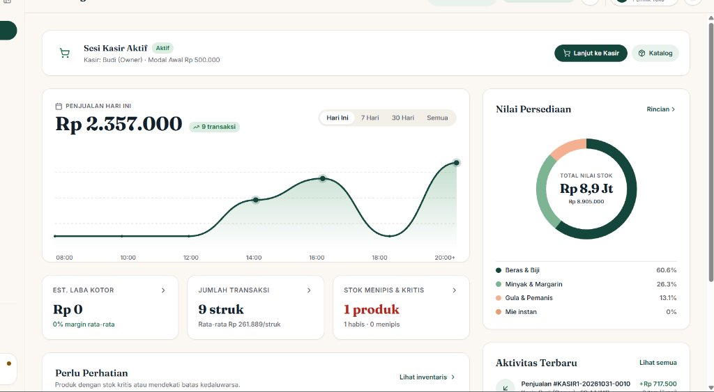
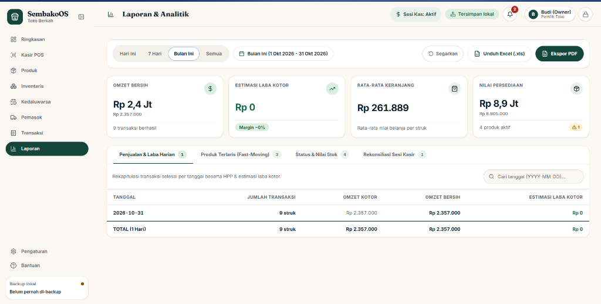
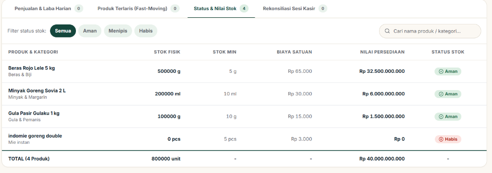
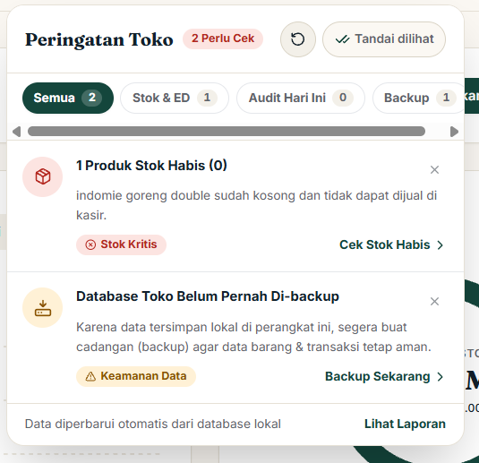
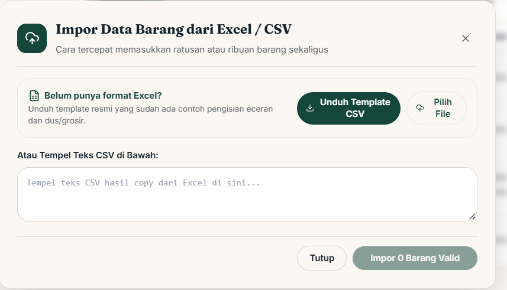
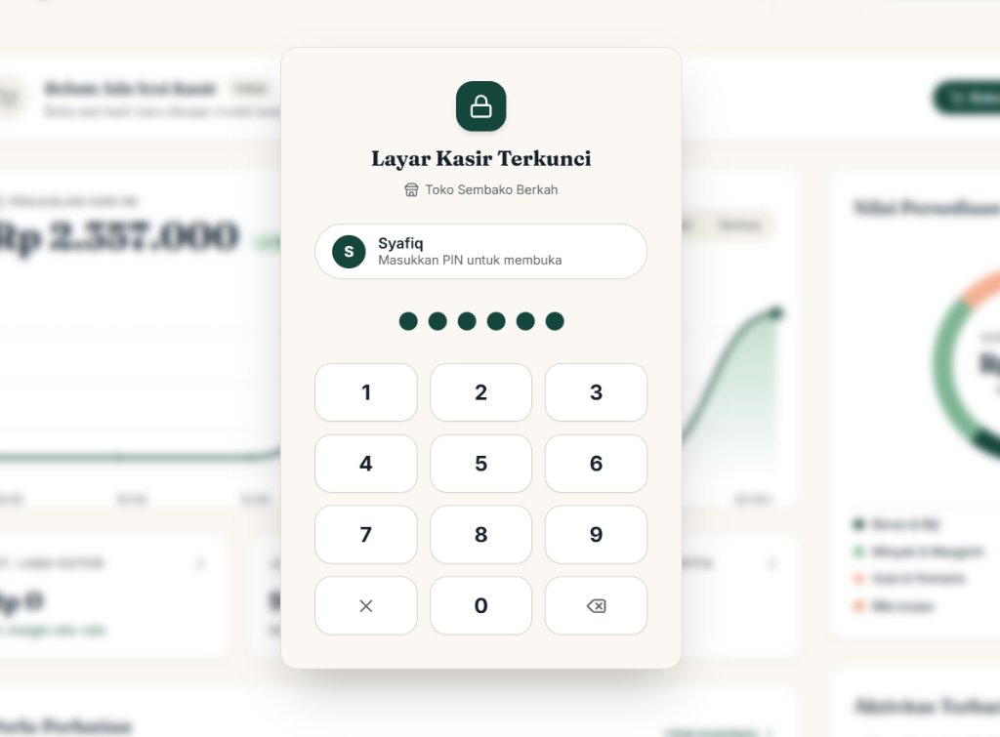
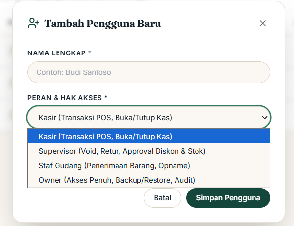
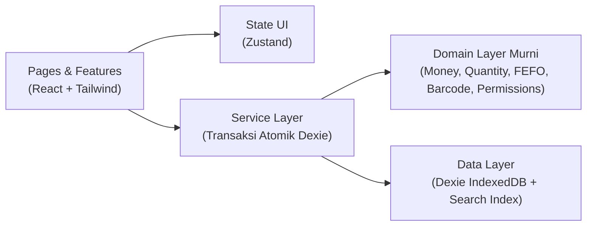

# SembakoOS

**Aplikasi Kasir (POS) & Manajemen Inventaris Offline-First untuk Toko Sembako**

[](https://www.typescriptlang.org/)
[](https://react.dev/)
[](https://dexie.org/)
[-14463C)](./TESTING.md)
[](./DATABASE.md)

SembakoOS adalah Progressive Web App (PWA) kasir dan pengelolaan stok untuk satu toko sembako fisik. Seluruh transaksi penjualan, mutasi stok, stok opname, pemantauan kedaluwarsa, hingga laporan laba rugi berjalan 100% lokal di tablet Android atau komputer kasir menggunakan IndexedDB tanpa ketergantungan koneksi internet.

---

## Tangkapan Layar Antarmuka

### 1. Ringkasan Operasional & Grafik Penjualan Harian
Pantau omzet harian per jam, jumlah struk, estimasi laba kotor, proporsi nilai stok per kategori, serta aktivitas kasir terkini dalam satu layar.



---

### 2. Laporan Keuangan, Analisis Laba & Ekspor Dokumen Resmi
Rekapitulasi omzet kotor, omzet bersih, HPP, dan estimasi laba kotor harian. Mendukung ekspor langsung ke dokumen **Microsoft Excel (`.xls`)** siap olah dan **Dokumen Cetak PDF (A4)** berformat kop resmi toko.



---

### 3. Valuasi Persediaan & Konversi Multi-Satuan
Pelacakan stok fisik gabungan (toko depan dan gudang belakang) dalam satuan kemasan maupun satuan dasar terkecil (`g`, `ml`, `pcs`), dilengkapi kalkulasi nilai modal persediaan otomatis.



---

### 4. Pusat Peringatan Toko & Impor Katalog Massal
Deteksi cepat untuk produk habis, stok menipis, batch mendekati kedaluwarsa, serta pengingat pencadangan (*backup*) database lokal. Dilengkapi asisten impor katalog dari Excel/CSV.

| Pusat Peringatan Operasional | Impor Katalog dari Excel / CSV |
| :---: | :---: |
|  |  |

---

### 5. Keamanan PIN 6-Digit, Alih Peran & Kontrol Akses
Penguncian layar kasir dengan enkripsi PIN PBKDF2-SHA256, perpindahan cepat antar staf (*Switch User/Role*), dan pembagian hak akses empat peran toko.

| Layar Kunci Kasir (PIN 6-Digit) | Manajemen Peran & Hak Akses |
| :---: | :---: |
|  |  |

---

## Prinsip Arsitektur & Integritas Data

1. **Satu Inventaris Gabungan (*Single Shared Inventory*)**  
   Toko depan dan gudang belakang menggunakan satu saldo stok yang sama. Tidak ada kerumitan transfer antar-lokasi di dalam satu toko.
2. **Offline-First Mutlak**  
   Semua operasi bisnis dieksekusi di penyimpanan lokal perangkat (IndexedDB/Dexie). Aplikasi tetap beroperasi penuh saat internet mati.
3. **Uang Integer Rupiah & Kuantitas Satuan Dasar**  
   - Uang disimpan sebagai **integer Rupiah** murni (tanpa *floating-point* untuk mencegah selisih pembulatan).
   - Kuantitas disimpan dalam **integer satuan dasar** (`qty_base`).
   - Harga pokok per satuan dasar disimpan menggunakan skala presisi `_x10k` ($\times 10.000$).
4. **Satu Pintu Mutasi Stok (*Append-Only Stock Ledger*)**  
   Saldo di tabel `inventory_balances` tidak pernah diedit langsung. Setiap perubahan stok wajib melewati `InventoryService` yang mencatat buku besar `stock_movements` dan `stock_movement_items` dalam satu transaksi Dexie atomik.
5. **Alokasi Batch FEFO (*First-Expired, First-Out*) Otomatis**  
   Saat kasir menjual barang yang memiliki pelacakan kedaluwarsa, sistem otomatis memotong stok dari batch dengan tanggal kedaluwarsa terdekat dan menolak penjualan batch yang telah kedaluwarsa.
6. **Snapshot Transaksi Kekal**  
   Setiap item penjualan menyimpan salinan permanen nama produk, satuan, faktor konversi, harga jual (`unit_price_snapshot`), dan modal pokok (`unit_cost_x10k_snapshot`) saat transaksi terjadi. Perubahan harga di masa depan tidak mengubah laporan laba masa lalu.

---

## Modul & Kapabilitas Sistem

| Modul | Kapabilitas Utama |
| :--- | :--- |
| **Kasir POS & Pembayaran** | Target sentuh $\ge 56\text{ px}$, pemindaian barcode perangkat keras, pencarian instan (<100 ms), satuan bertingkat (Pcs/Renceng/Dus), diskon item & nota, *Hold/Resume* keranjang pelanggan, pembayaran Tunai & Non-Tunai Manual (QRIS Statis, Transfer Bank, Debit/EDC). |
| **Struk Thermal & Barcode Struk** | Cetak struk kertas thermal **58mm** & **80mm** via iframe terisolasi, unggah logo toko dengan filter *1-bit monochrome thresholding* otomatis, monogram inisial toko, serta barcode nomor struk **Code-128** untuk fitur *Scan-to-Return* di kasir. |
| **Rekonsiliasi Sesi Kasir** | Buka sesi kasir dengan modal awal laci, rincian transparan perhitungan kas sistem (Modal Awal + Penjualan Tunai $-$ Refund Retur), deteksi selisih kas otomatis, dan kewajiban catatan alasan jika kas tidak klop. |
| **Katalog, EAN-13 & Deteksi Duplikat** | Multi-satuan & multi-barcode per produk, pembuatan **Barcode Internal Toko (EAN-13 Prefix `20`)** untuk barang curah/repack, cetak label rak/produk (50×30mm, 40×30mm, A4 3×8), serta **Asisten Auto-Deteksi & Penggabungan Barang Duplikat** (Token Dice fuzzy matching & mutasi stok atomik). |
| **Penerimaan Pemasok & Opname** | Pencatatan nota kulakan pemasok (*Goods Receipt*) dengan perhitungan *Moving Average Cost* otomatis, koreksi salah catat (*Reversal*), penyesuaian barang rusak (`DAMAGE_SPOILAGE`), serta sesi **Stok Opname** fisik. |
| **Kedaluwarsa & FEFO** | Klasifikasi batch otomatis (*Aman*, *Waspada H-30*, *Kritis H-7*, *Kedaluwarsa*) dan aksi pengeluaran barang kedaluwarsa (*Write-Off*) dari stok aktif. |
| **Backup & Audit Invarian** | Ekspor basis data penuh ke JSON dengan **Checksum SHA-256**, pemulihan (*Restore*) atomik dengan validasi skema, serta pemeriksa otomatis **6 Invarian Database** (`pnpm db:check`). |

---

## Matriks Hak Akses Peran (*Role-Based Access Control*)

Otorisasi divalidasi langsung pada lapisan bisnis (`authorize()`) di setiap service, bukan sekadar menyembunyikan tombol antarmuka:

| Hak Akses / Operasi | Kasir (`cashier`) | Staf Gudang (`stock_clerk`) | Supervisor (`supervisor`) | Pemilik (`owner`) |
| :--- | :---: | :---: | :---: | :---: |
| Buka/Tutup Sesi Kas, Transaksi POS, Cetak Struk | ✅ | ❌ | ✅ | ✅ |
| Lihat Riwayat Struk Sendiri | ✅ | ❌ | ✅ | ✅ |
| Tambah/Edit Produk, Cetak Label, Penerimaan Kulakan | ❌ | ✅ | ✅ | ✅ |
| Stok Opname (Hitung) & Koreksi Barang Rusak | ❌ | ✅ | ✅ | ✅ |
| Void Transaksi, Retur Pelanggan & Diskon Override | ❌ | ❌ | ✅ | ✅ |
| Ubah Harga Jual & Posting Hasil Stok Opname | ❌ | ❌ | ✅ | ✅ |
| Lihat Laporan Laba Kotor, HPP & Audit Log | ❌ | ❌ | ✅ | ✅ |
| Buat Cadangan (*Backup*) Database Lokal | ❌ | ❌ | ✅ | ✅ |
| Pulihkan (*Restore*) Database, Kelola Staf & Pengaturan | ❌ | ❌ | ❌ | ✅ |

---

## Arsitektur Lapisan Kode



```text
src/
├── components/           # Komponen UI bersama, Layout responsif, PinPad, dan Popover Notifikasi
├── data/                 # Skema Dexie IndexedDB (18 tabel), indeks pencarian, dan seeder demo
├── domain/               # Logika bisnis murni (0 dependensi React/Dexie):
│   ├── audit/            # Pemeriksa 6 invarian database (verify-invariants.ts)
│   ├── auth/             # PBKDF2-SHA256 PIN hashing & verifikasi
│   ├── barcode/          # Generator EAN-13 (Prefix 20) & Code-128 Set B
│   ├── catalog/          # Algoritma normalisasi teks & deteksi produk duplikat
│   ├── inventory/        # Alokasi batch FEFO & perhitungan kedaluwarsa
│   ├── money/            # Operasi uang integer Rupiah & pembulatan setengah ke atas
│   ├── permissions/      # Matriks izin peran & fungsi authorize()
│   └── quantity/         # Konversi multi-satuan ke qty_base integer
├── features/             # Modul fitur (auth, pos, catalog, inventory, expiry, suppliers, transactions, reports, settings)
├── lib/                  # Parser multi-format CSV/Excel (.xls), pencetakan iframe terisolasi, helper format id-ID
└── services/             # Orkestrasi transaksi atomik Dexie (Checkout, Inventory, Catalog, Session, Receipt, Label, Report, Backup)
```

---

## Instalasi & Penggunaan

### Prasyarat
- **Node.js** v18+ atau v20+
- **pnpm** v9+

### 1. Kloning & Pasang Dependensi
```bash
git clone https://github.com/SyafiqSiregar/Sembako.git
cd Sembako
pnpm install
```

### 2. Jalankan Server Pengembangan
```bash
pnpm dev
```
Buka `http://localhost:3000` di browser. Akun pemilik bawaan saat pertama kali dijalankan:
- **Pengguna**: `Budi (Owner)`
- **PIN Default**: `123456`

### 3. Muat Data Demo (Opsional)
Untuk mencoba aplikasi dengan data contoh sembako lengkap (beras, minyak, mie instan, gula, batch kedaluwarsa, pemasok, dan contoh transaksi):
```bash
pnpm seed:demo
```

---

## Pengujian & Verifikasi Kualitas

Seluruh aturan bisnis, perhitungan uang/stok, dan skenario operasional diuji menggunakan **Vitest** dan **Fake-IndexedDB** (**33 berkas uji, 160 tes otomatis**):

```bash
# 1. Pemeriksaan tipe TypeScript (Strict Mode)
pnpm typecheck

# 2. Jalankan seluruh 160 unit & integration tests (termasuk simulasi UAT 1 hari penuh)
pnpm test

# 3. Verifikasi 6 Invarian Database (Saldo vs Ledger, Snapshot, FEFO, Non-Negatif)
pnpm db:check

# 4. Kompilasi bundle produksi PWA
pnpm build
```

---

## Dokumen Referensi Proyek

- [`PRD.md`](./PRD.md) — Spesifikasi kebutuhan produk, aturan bisnis (`BR-01`..`BR-25`), dan *acceptance criteria* (`AC-01`..`AC-40`).
- [`ARCHITECTURE.md`](./ARCHITECTURE.md) — Arsitektur lapisan, manajemen state, keamanan PIN, dan mekanisme offline-first.
- [`DATABASE.md`](./DATABASE.md) — Definisi 18 tabel IndexedDB, indeks komposit, dan batasan transaksi atomik.
- [`DESIGN_SYSTEM.md`](./DESIGN_SYSTEM.md) — Sistem token warna, tipografi, ukuran sentuh tablet, dan standar komponen.
- [`TESTING.md`](./TESTING.md) — Strategi pengujian domain, integrasi service, dan skenario akhir-ke-akhir.
- [`docs/uat-checklist-manual.md`](./docs/uat-checklist-manual.md) — Lembar *checklist* pengujian lapangan (UAT) pada tablet Android dan printer thermal fisik.
- [`CHANGELOG.md`](./CHANGELOG.md) — Catatan rinci riwayat fitur, perbaikan bug, dan keputusan arsitektur.

---

## Lisensi

Hak Cipta © 2026 Syafiq Siregar. Seluruh hak cipta dilindungi undang-undang.
