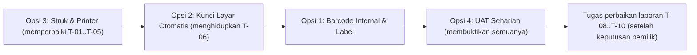
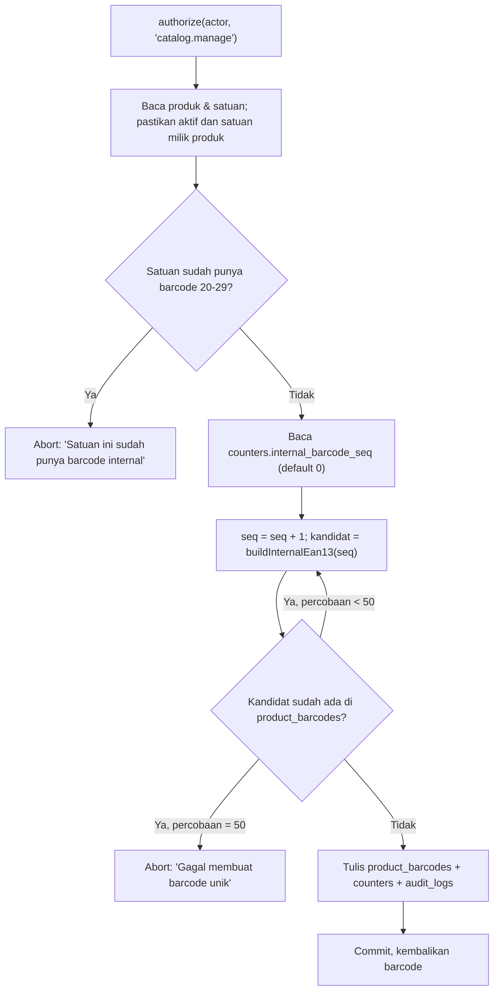
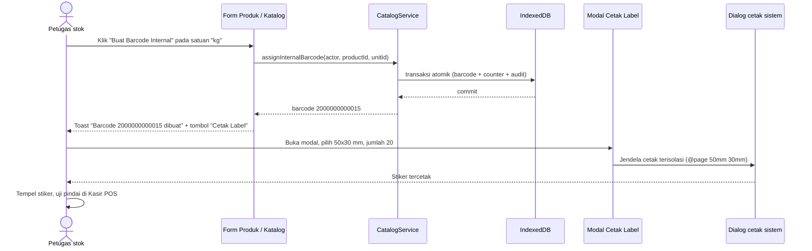
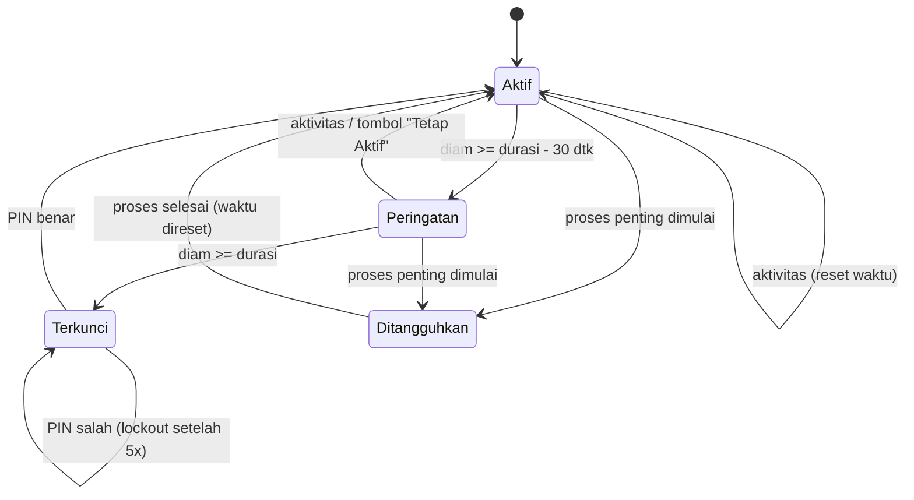
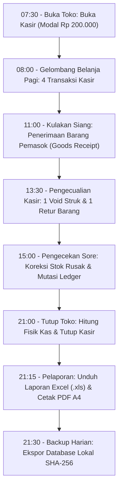

# Rencana Lanjutan — SembakoOS

Rencana kerja pasca-MVP untuk empat opsi lanjutan: barcode internal & cetak label, kunci layar otomatis, kustomisasi struk & printer thermal, serta simulasi operasional seharian (UAT).

| Atribut | Nilai |
| --- | --- |
| Versi dokumen | 1.0 (draf untuk ditinjau pemilik) |
| Tanggal | 30 Oktober 2026 |
| Status | **Belum dikerjakan.** Menunggu persetujuan urutan dan keputusan terbuka (§6) |
| Mengacu ke | `AGENTS.md`, `PRD.md` v1.1, `ARCHITECTURE.md`, `DATABASE.md`, `DESIGN_SYSTEM.md`, `TASKS.md` |
| Basis kode | Commit `085c017` (`main`) |

> Dokumen ini adalah **rencana**, bukan bukti selesai. Semua nilai bertanda **[USULAN]** belum diputuskan pemilik dan akan dibuat dapat dikonfigurasi (AGENTS.md §3 Aturan 1). Bagian yang hanya bisa dibuktikan dengan perangkat fisik (pemindai, printer thermal, tablet) ditandai **"perlu uji perangkat"**.

---

## Daftar Isi

0. [Ringkasan, Temuan Audit Kode, dan Urutan Rekomendasi](#0-ringkasan-temuan-audit-kode-dan-urutan-rekomendasi)
1. [Opsi 1 — Barcode Internal & Cetak Label (FR-CAT-11)](#1-opsi-1--barcode-internal--cetak-label-fr-cat-11)
2. [Opsi 2 — Kunci Layar Otomatis (FR-AUTH-04)](#2-opsi-2--kunci-layar-otomatis-fr-auth-04)
3. [Opsi 3 — Kustomisasi Struk & Printer Thermal 58/80 mm](#3-opsi-3--kustomisasi-struk--printer-thermal-5880-mm)
4. [Opsi 4 — Simulasi Operasional Seharian (UAT)](#4-opsi-4--simulasi-operasional-seharian-uat)
5. [Ringkasan Berkas, Estimasi, dan Urutan Commit](#5-ringkasan-berkas-estimasi-dan-urutan-commit)
6. [Pertanyaan Terbuka untuk Pemilik](#6-pertanyaan-terbuka-untuk-pemilik)
7. [Lampiran: Aturan Umum & Template Laporan](#7-lampiran-aturan-umum--template-laporan)

---

## 0. Ringkasan, Temuan Audit Kode, dan Urutan Rekomendasi

### 0.1 Temuan saat memeriksa kode sekarang

Sebelum menyusun rencana, kode yang ada diperiksa. Beberapa temuan mengubah prioritas karena sebagian "fitur lanjutan" ternyata sudah setengah ada tetapi **tidak tersambung**:

| # | Temuan | Lokasi | Dampak | Ditangani di |
| --- | --- | --- | --- | --- |
| T-01 | Struk kasir **tidak memakai identitas toko dari Pengaturan**. `PosView` tidak mengirim `storeName/storeAddress/storePhone`, sehingga struk selalu memakai nilai default yang ditulis di komponen (`Jl. Pasar Tradisional No. 12`). | `src/features/pos/PosView.tsx` (±baris 782), `src/features/pos/ReceiptModal.tsx` baris 20–23 | Struk mencetak alamat yang salah | Opsi 3 |
| T-02 | `receiptFooter` disimpan di Pengaturan tetapi **tidak pernah dipakai** di struk. Footer struk ditulis keras: *"Barang yang dibeli tidak dapat ditukar/dikembalikan kecuali ada perjanjian."* — **bertentangan** dengan kebijakan retur toko (`returnDaysLimit` = 7 hari). | `ReceiptModal.tsx` bagian Footer, `settings.service.ts` | Informasi ke pelanggan keliru | Opsi 3 |
| T-03 | Tidak ada CSS `@media print` di seluruh `src/`. `window.print()` di struk dan cetak ulang riwayat transaksi mencetak **seluruh halaman aplikasi**, bukan hanya struk. | `ReceiptModal.tsx` baris 35–37, `TransactionHistoryView.tsx` ±baris 733 | Struk di printer thermal berantakan | Opsi 3 |
| T-04 | Pilihan lebar kertas 58/80 mm hanya `useState` lokal, kembali ke 58 mm setiap kali modal dibuka. | `ReceiptModal.tsx` baris 25 | Kasir harus memilih ulang tiap transaksi | Opsi 3 |
| T-05 | `ReceiptModal` memakai warna heksadesimal & `stone-*`/`emerald-*` langsung, bukan token desain. | `ReceiptModal.tsx` | Melanggar AGENTS.md §4.5 | Opsi 3 |
| T-06 | Pengaturan `autoLockMinutes` (default 15) **dapat diisi dan disimpan, tetapi tidak ada timer yang menjalankannya**. Ini kontrol yang tampak aktif namun tidak berfungsi. | `StoreSettingsTab.tsx` baris 176–177, tidak ada pemakai lain | Melanggar semangat AGENTS.md §3 Aturan 4 | Opsi 2 |
| T-07 | Saat aplikasi dibuka/dimuat ulang, `initialize()` langsung memakai **pengguna aktif pertama tanpa PIN**, dan status `isLocked` hanya disimpan di memori. Muat ulang halaman = kunci layar terlewati. | `src/features/auth/authStore.ts` baris 39–72, 103–105 | Celah akses (FR-AUTH-01) | Dicatat di Opsi 2, **butuh keputusan pemilik** (OQ-L05) |
| T-08 | Laporan menghitung **refund retur dari harga modal (HPP)** pergerakan `CUSTOMER_RETURN`, bukan dari uang yang benar-benar dikembalikan (`returns.total_refund`). Retur barang rusak/kedaluwarsa (`RETURN_WRITE_OFF`) tidak ikut dihitung sama sekali, padahal uangnya tetap dikembalikan. Rekonsiliasi kas memakai `total_refund` → **laporan dan kas tidak konsisten**. | `src/services/report.service.ts` baris 146–161 vs `session.service.ts` baris 84–114 | Omzet bersih & laba bisa salah | Ditemukan untuk Opsi 4; perbaikan = tugas terpisah (OQ-L09) |
| T-09 | Pengelompokan harian laporan memakai `toISOString()` (UTC), bukan zona waktu toko. Penjualan pukul 00.00–06.59 WIB masuk ke tanggal sebelumnya. Kolom "Omzet Bersih" harian memakai `sale.total` tanpa mengurangi retur. | `report.service.ts` baris 124, 142 | Laporan harian bergeser | Opsi 4 (tugas perbaikan terpisah) |
| T-10 | `Math.round` dan `Math.max(0, …)` dipakai langsung pada uang di laporan. `Math.max(0, …)` menyembunyikan laba negatif (rugi). | `report.service.ts` baris 136, 156, 161–165 | Melanggar AGENTS.md §4.1 & §8 | Opsi 4 (tugas perbaikan terpisah) |
| T-11 | Skrip `pnpm test:e2e` dan `pnpm db:check` disebut di AGENTS.md §6 tetapi **belum ada** di `package.json`. Playwright belum terpasang. | `package.json` | Verifikasi e2e belum mungkin | Opsi 4 |
| T-12 | Koreksi atas jawaban sebelumnya: berkas backup bernama `sembako-backup-YYYYMMDD-HHMM.json`, **bukan** `.sembako`. | `src/services/backup.service.ts` baris 96 | — | Dokumen ini |

> T-08 s.d. T-10 menyangkut **akurasi uang** (prinsip produk #1). Rencana ini tidak memperbaikinya diam-diam. Opsi 4 dirancang supaya temuan seperti ini terbukti lewat tes, lalu diperbaiki sebagai tugas tersendiri setelah pemilik menyetujui definisi metriknya (AGENTS.md §9).

### 0.2 Urutan pengerjaan yang direkomendasikan



| Urutan | Opsi | Alasan |
| --- | --- | --- |
| 1 | **Opsi 3** | Memperbaiki cacat yang sudah dialami pelanggan setiap transaksi (alamat salah, footer bertentangan, cetak seluruh halaman). Juga membangun utilitas cetak (`lib/print.ts`) yang dipakai ulang Opsi 1. |
| 2 | **Opsi 2** | Kecil, berisiko rendah, dan menghilangkan pengaturan "mati" (T-06). |
| 3 | **Opsi 1** | Fitur baru terbesar; memakai utilitas cetak dari Opsi 3. |
| 4 | **Opsi 4** | Dijalankan terakhir agar menguji fitur yang sudah final. Bagian otomatisnya boleh dimulai lebih awal untuk menangkap T-08..T-10. |

Sesuai AGENTS.md §3 Aturan 10, setiap opsi dipecah menjadi tugas bernomor (`T6.xx`) dan dikerjakan **satu per satu**, masing-masing dengan cabang, tes, dan laporan sendiri.

### 0.3 Penomoran tugas yang diusulkan untuk `TASKS.md` (Fase 6)

| Kode | Judul | Opsi |
| --- | --- | --- |
| T6.01 | Utilitas cetak dokumen terisolasi (`lib/print.ts`) | 3 |
| T6.02 | Pengaturan struk (lebar kertas, kebijakan retur) + skema Zod | 3 |
| T6.03 | Generator HTML struk (`receipt.service.ts`) + tes | 3 |
| T6.04 | Redesain `ReceiptModal` + sambungan Pengaturan + cetak ulang riwayat | 3 |
| T6.05 | Tab "Struk & Printer" di Pengaturan + pratinjau langsung + struk uji | 3 |
| T6.06 | Fungsi domain `evaluateIdle` + hook `useAutoLock` | 2 |
| T6.07 | Integrasi auto-lock di `AppLayout`, penangguhan saat pembayaran, banner peringatan | 2 |
| T6.08 | Pengaturan durasi auto-lock (validasi, preset) | 2 |
| T6.09 | Domain EAN-13 (check digit, encoder, SVG) | 1 |
| T6.10 | `CatalogService.assignInternalBarcode` (atomik, audit, izin) | 1 |
| T6.11 | Tombol "Buat Barcode Internal" di form produk & katalog | 1 |
| T6.12 | Modal Cetak Label + generator HTML label (thermal & A4) | 1 |
| T6.13 | Pemeriksa invarian ledger (`verifyLedgerInvariants`) + skrip `db:check` | 4 |
| T6.14 | Tes integrasi skenario "Satu Hari Operasional" | 4 |
| T6.15 | Checklist UAT manual di perangkat + laporan hasil | 4 |
| T6.16 | (Opsional, butuh persetujuan dependensi) Playwright e2e | 4 |

---

## 1. Opsi 1 — Barcode Internal & Cetak Label (FR-CAT-11)

### 1.1 Tujuan

Barang tanpa barcode pabrik (beras/gula/telur repack, minyak plastik, kerupuk kiloan) dapat diberi barcode toko, dicetak sebagai stiker, lalu dipindai di Kasir POS seperti barang pabrikan.

| Ref | Isi | Prioritas |
| --- | --- | --- |
| PRD FR-CAT-11 | Pembuatan dan pencetakan barcode internal untuk produk tanpa barcode pabrik atau dijual curah | P1 |
| PRD FR-CAT-03 | Barcode harus unik; duplikasi ditolak | P0 |
| PRD §5.2 | Tambah/ubah produk: Owner, Supervisor, Petugas stok | — |

### 1.2 Kondisi saat ini

- Tabel `product_barcodes` sudah ada dengan indeks unik `&barcode` (`src/data/db.ts` baris 416). Kolomnya: `id, product_id, product_unit_id, barcode, created_at`.
- Tabel `counters` (`key`, `value`) sudah ada (dipakai untuk nomor urut) — cocok untuk nomor urut barcode internal.
- `CatalogService.createProduct` sudah memvalidasi keunikan barcode dan menyebut nama produk pemiliknya (AC-38).
- Belum ada generator barcode, belum ada render gambar barcode, belum ada cetak label.
- Izin yang sudah ada: `catalog.manage` (`src/domain/permissions/index.ts`).

### 1.3 Ruang lingkup

**Termasuk:**
1. Membuat barcode internal EAN-13 untuk satu satuan jual (eceran atau dus) dari sebuah produk.
2. Menyimpan barcode tersebut sebagai baris `product_barcodes` biasa (langsung bisa dipindai di POS).
3. Mencetak label stiker berisi nama barang, satuan, barcode, dan (opsional) harga.
4. Tiga format kertas: stiker thermal 50×30 mm, stiker thermal 40×30 mm, lembar stiker A4 3×8.

**Tidak termasuk (dicatat untuk nanti):**
- Barcode berat-variabel (harga/berat tertanam di barcode dari timbangan). Bergantung pada OQ-01 (penjualan kuantitas desimal) dan perangkat timbangan.
- Mengganti barcode pabrik yang sudah ada.
- Desain label bebas (drag & drop). Hanya preset.
- Pengiriman perintah langsung ke printer (ESC/POS, WebUSB, WebBluetooth). Cetak lewat dialog cetak sistem.

### 1.4 Aturan bisnis yang diusulkan

| Kode | Aturan | Status |
| --- | --- | --- |
| BL-01 | Format barcode internal: **EAN-13 berawalan `20`** → `20` + 10 digit nomor urut + 1 digit pemeriksa. Contoh nomor urut 1 → `2000000000015`. | [USULAN] |
| BL-02 | Awalan GS1 `20`–`29` dicadangkan untuk peredaran terbatas di dalam toko sendiri, sehingga tidak bentrok dengan barcode pabrik resmi. Awalan dapat diganti lewat konstanta konfigurasi. | [USULAN] |
| BL-03 | Nomor urut diambil dari `counters` dengan kunci `internal_barcode_seq`, naik 1 setiap pembuatan, di dalam transaksi yang sama dengan penyimpanan barcode. | Teknis |
| BL-04 | Bila barcode hasil generator sudah dipakai (mis. pernah diketik manual), nomor urut dilewati dan dicoba nomor berikutnya, maksimal 50 kali; lebih dari itu → galat yang jelas. | Teknis |
| BL-05 | Satu satuan jual boleh punya barcode pabrik **dan** barcode internal. Tombol "Buat Barcode Internal" hanya muncul bila satuan itu **belum** punya barcode berawalan `20`–`29`. | [USULAN] |
| BL-06 | Membuat barcode internal adalah perubahan produk → wajib izin `catalog.manage` dan menulis `audit_logs` (aksi `catalog.barcode_internal_create`) dalam transaksi yang sama. | Mengikuti AGENTS.md §4.3 |
| BL-07 | Mencetak label **tidak** mengubah data → tidak membuat audit log dan tidak butuh izin khusus selain akses halaman katalog. | [USULAN] |
| BL-08 | Bila label menampilkan harga, label menulis harga saat dicetak. Saat harga berubah, sistem **tidak** dapat mengubah stiker yang sudah tertempel → modal cetak menampilkan peringatan dan opsi "Tampilkan harga" bawaan **mati**. | [USULAN], OQ-L03 |
| BL-09 | Barcode internal tidak dihapus fisik bila sudah dipakai di transaksi (AGENTS.md §4.2). Penonaktifan barcode di luar lingkup tugas ini. | Mengikuti aturan |

### 1.5 Desain data

**Tidak ada perubahan skema.** Tidak perlu `this.version(2)`.

| Tabel | Pemakaian |
| --- | --- |
| `product_barcodes` | Baris baru: `{ id, product_id, product_unit_id, barcode: '2000000000015', created_at }` |
| `counters` | Baris `{ key: 'internal_barcode_seq', value: <terakhir> }`, dibuat saat pertama dipakai |
| `audit_logs` | Satu baris per pembuatan barcode (sebelum: `null`, sesudah: `{ barcode, unitCode }`) |

Barcode internal dikenali dari awalannya (`/^2[0-9]{12}$/`), jadi tidak perlu kolom `is_internal`.

### 1.6 Desain domain: `src/domain/barcode/ean13.ts`

Murni, tanpa React/Dexie, tanpa dependensi baru (AGENTS.md §4.4). Render EAN-13 cukup ±120 baris; memakai pustaka (mis. JsBarcode, MIT) butuh persetujuan dan tidak diperlukan.

```ts
/** Menghitung digit pemeriksa EAN-13 dari 12 digit pertama. */
export function ean13CheckDigit(first12: string): number;

/** true bila 13 digit dan digit pemeriksanya benar. */
export function isValidEan13(code: string): boolean;

/** Membentuk barcode internal dari nomor urut. Lempar galat bila nomor urut > 10 digit. */
export function buildInternalEan13(sequence: number, prefix = '20'): string;

/** true bila barcode berada di rentang peredaran toko (20–29). */
export function isInternalBarcode(code: string): boolean;

/** Mengubah 13 digit menjadi 95 modul ('1' = batang hitam, '0' = putih). */
export function encodeEan13Modules(code: string): string;

/** Menghasilkan SVG string siap cetak (crispEdges, tanpa skrip). */
export function renderEan13Svg(code: string, opts: { moduleMm: number; barHeightMm: number; showText: boolean }): string;
```

Rumus digit pemeriksa: jumlahkan digit posisi ganjil (bobot 1) dan genap (bobot 3) dari 12 digit pertama; `check = (10 − (jumlah mod 10)) mod 10`.

Contoh perhitungan `200000000001?`:

| Posisi | 1 | 2 | 3 | 4 | 5 | 6 | 7 | 8 | 9 | 10 | 11 | 12 |
| --- | --- | --- | --- | --- | --- | --- | --- | --- | --- | --- | --- | --- |
| Digit | 2 | 0 | 0 | 0 | 0 | 0 | 0 | 0 | 0 | 0 | 0 | 1 |
| Bobot | 1 | 3 | 1 | 3 | 1 | 3 | 1 | 3 | 1 | 3 | 1 | 3 |

Jumlah = 2 + 3 = 5 → check = 5 → **`2000000000015`**.

Tabel pengodean (standar EAN-13):

| Digit | L (ganjil) | G (genap) | R (kanan) |
| --- | --- | --- | --- |
| 0 | 0001101 | 0100111 | 1110010 |
| 1 | 0011001 | 0110011 | 1100110 |
| 2 | 0010011 | 0011011 | 1101100 |
| 3 | 0111101 | 0100001 | 1000010 |
| 4 | 0100011 | 0011101 | 1011100 |
| 5 | 0110001 | 0111001 | 1001110 |
| 6 | 0101111 | 0000101 | 1010000 |
| 7 | 0111011 | 0010001 | 1000100 |
| 8 | 0110111 | 0001001 | 1001000 |
| 9 | 0001011 | 0010111 | 1110100 |

Pola paritas 6 digit kiri ditentukan digit pertama: `0 LLLLLL, 1 LLGLGG, 2 LLGGLG, 3 LLGGGL, 4 LGLLGG, 5 LGGLLG, 6 LGGGLL, 7 LGLGLG, 8 LGLGGL, 9 LGGLGL`. Untuk awalan `2` → `LLGGLG`.

Struktur: penjaga kiri `101` + 6×7 modul + penjaga tengah `01010` + 6×7 modul + penjaga kanan `101` = **95 modul**. Zona sepi: 11 modul kiri, 7 modul kanan.

### 1.7 Ukuran fisik barcode (penting untuk printer thermal)

Printer thermal umum beresolusi 203 dpi (1 titik ≈ 0,125 mm). Lebar modul sebaiknya kelipatan titik agar batang tidak kabur.

| Preset | Modul | Lebar batang (95 modul) | + zona sepi (18 modul) | Muat? | Catatan |
| --- | --- | --- | --- | --- | --- |
| 50×30 mm | 3 titik = 0,375 mm | 35,6 mm | 42,4 mm | Ya (margin 3,8 mm kiri-kanan) | **Direkomendasikan** |
| 40×30 mm | 2 titik = 0,25 mm | 23,8 mm | 28,3 mm | Ya | Di bawah batas minimum GS1 (0,264 mm). Banyak pemindai tetap membaca, **wajib uji perangkat** |
| A4 3×8 (70×37 mm) | 0,33 mm (100%) | 31,4 mm | 37,3 mm | Ya | Printer laser/inkjet, skala 100% |

Tinggi batang dipotong (truncated) menjadi ±12 mm pada label 30 mm agar muat nama dan harga. Ini lazim untuk pemakaian di dalam toko, tetapi tetap **perlu uji perangkat** dengan pemindai toko.

Dialog cetak browser wajib di **skala 100% / "Ukuran sebenarnya"**. Modal cetak menampilkan pengingat ini.

### 1.8 Desain service

Tambahan di `src/services/catalog.service.ts` (atau `barcode.service.ts` bila `catalog.service.ts` melewati 300 baris setelah ditambah — AGENTS.md §4.4):

```ts
assignInternalBarcode(params: {
  actor: Actor;              // pengguna aktif
  productId: string;
  productUnitId: string;
}): Promise<{ barcode: string }>;
```

Alur di dalam **satu** transaksi Dexie (`rw`, tabel: `products, product_units, product_barcodes, counters, audit_logs`):



- `authorize` dipanggil **sebelum** transaksi dibuka.
- Galat bisnis di dalam transaksi memakai pola `Abort` (melempar) agar transaksi batal — bukan `Result.err` (AGENTS.md §4.2).
- Tidak ada `await` non-IndexedDB di dalam transaksi.
- `id` dan waktu dari `IdGenerator` dan `Clock` yang disuntikkan.
- Setelah commit, indeks pencarian POS (`ProductSearchIndex`) dimuat ulang oleh pemanggil UI, bukan dari dalam transaksi.

### 1.9 Alur pengguna



### 1.10 Wireframe

**A. Form produk — baris satuan tanpa barcode** (`ProductFormModal.tsx`, kotak "Penjualan Eceran"):

```
┌ Penjualan Eceran (Satuan Utama) ─────────────────────────────────────┐
│ Satuan          Harga modal        Harga jual                        │
│ [ kg      ▾]    [Rp 14.000     ]   [Rp 17.500     ]                  │
│                                                                      │
│ Barcode (opsional)                                                   │
│ [ Pindai atau ketik barcode pabrik...          ]                     │
│ Barang curah tanpa barcode?  [ Buat Barcode Internal ]               │
│ Barcode toko berawalan 20, bisa dicetak sebagai stiker.              │
└──────────────────────────────────────────────────────────────────────┘
```

- Pada **produk baru** (belum tersimpan), tombol nonaktif dengan teks bantu *"Simpan barang dulu, lalu buat barcode internal."* (tidak ada tombol palsu; alasan nonaktif terbaca — DESIGN_SYSTEM.md §6.1).
- Setelah berhasil, field menampilkan barcode, badge `Internal`, dan tombol `Cetak Label`.

**B. Katalog produk — aksi per baris** (`ProductCatalogView.tsx`):

```
┌ Katalog Produk ──────────────────────────────────── [Cetak Label] [+ Tambah] ┐
│ [Cari nama / barcode ...]   Kategori [Semua ▾]   Status [Aktif ▾]            │
├──────────────────────────────────────────────────────────────────────────────┤
│ Nama barang           Satuan   Harga jual   Barcode            Aksi          │
│ Gula Pasir Curah      kg       Rp 17.500    2000000000015 Int  [Label] [⋯]   │
│ Telur Ayam            pak      Rp 28.000    — belum ada —      [Buat] [⋯]    │
│ Indomie Goreng        bks      Rp 3.500     089686010015       [Label] [⋯]   │
└──────────────────────────────────────────────────────────────────────────────┘
```

- `[Buat]` = Buat Barcode Internal (hanya untuk peran dengan `catalog.manage`; tetap divalidasi di service).
- `[Label]` membuka modal cetak dengan barang itu sudah terpilih.
- Tombol `Cetak Label` di toolbar membuka modal kosong untuk memilih banyak barang.

**C. Modal Cetak Label — tablet landscape / desktop (≥ 1024 px):**

```
┌ Cetak Label Barcode ─────────────────────────────────────────────────────── [×] ┐
│ Pilih barang, jumlah stiker, dan ukuran kertas.                                 │
├────────────────────────────────────────────┬────────────────────────────────────┤
│ 1  BARANG                                  │ 3  PRATINJAU                       │
│ [Cari nama atau barcode...              ]  │  ┌──────────┐ ┌──────────┐         │
│ ┌────────────────────────────────────────┐ │  │TOKO BERKAH│ │TOKO BERKAH│       │
│ │ Gula Pasir Curah · kg                  │ │  │Gula Pasir │ │Gula Pasir │       │
│ │ 2000000000015              Internal    │ │  │▌█▐▌█▐█▌▐▌ │ │▌█▐▌█▐█▌▐▌ │       │
│ │ Jumlah stiker  [ − ]  20  [ + ]  [Hapus]│ │  │2 000000...│ │2 000000...│       │
│ ├────────────────────────────────────────┤ │  └──────────┘ └──────────┘         │
│ │ Telur Ayam · pak                       │ │                                    │
│ │ Belum punya barcode                    │ │  20 stiker · 20 halaman 50×30 mm   │
│ │ [Buat Barcode Internal]                │ │                                    │
│ └────────────────────────────────────────┘ │  ⚠ Atur skala cetak 100%           │
│                                            │    ("Ukuran sebenarnya").          │
│ 2  UKURAN KERTAS                           │                                    │
│ (•) Stiker thermal 50 × 30 mm  Disarankan  │                                    │
│ ( ) Stiker thermal 40 × 30 mm  Uji dulu    │                                    │
│ ( ) Lembar stiker A4 · 3 × 8 (70 × 37 mm)  │                                    │
│                                            │                                    │
│ [ ] Tampilkan harga jual                   │                                    │
│     Harga di stiker tidak ikut berubah     │                                    │
│     bila harga barang diubah nanti.        │                                    │
│ [✓] Tampilkan nama toko                    │                                    │
├────────────────────────────────────────────┴────────────────────────────────────┤
│ Total 20 stiker                                       [Batal]  [Cetak Label]    │
└─────────────────────────────────────────────────────────────────────────────────┘
```

**D. Modal Cetak Label — ponsel / tablet portrait (< 768 px):** satu kolom, pratinjau dilipat.

```
┌ Cetak Label Barcode ───── [×] ┐
│ 1 BARANG                      │
│ [Cari...                   ]  │
│ ┌───────────────────────────┐ │
│ │ Gula Pasir Curah · kg     │ │
│ │ 2000000000015  Internal   │ │
│ │ [ − ]  20  [ + ]  [Hapus] │ │
│ └───────────────────────────┘ │
│ 2 UKURAN KERTAS               │
│ (•) Thermal 50×30  Disarankan │
│ ( ) Thermal 40×30  Uji dulu   │
│ ( ) A4 · 3×8                  │
│ [ ] Tampilkan harga           │
│ [✓] Tampilkan nama toko       │
│ ▸ Lihat pratinjau (20 stiker) │
├───────────────────────────────┤
│ [Batal]        [Cetak Label]  │
└───────────────────────────────┘
```

**E. Tata letak stiker**

Thermal 50 × 30 mm (satu stiker = satu halaman `@page`):

```
┌──────────────────────────────────────────────┐  ← 50 mm
│ TOKO SEMBAKO BERKAH                  (7 pt)  │
│ Gula Pasir Curah 1 kg               (8,5 pt) │  maks. 2 baris, terpotong "…"
│ ▌▌█▐▌█▌▐█▌▌▐█▌▐▌█▐▌█▌▐▌▌▐█▌▐▌█▐▌█▌▐▌▌▐█▌▐▌  │  tinggi batang ±12 mm
│ ▌▌█▐▌█▌▐█▌▌▐█▌▐▌█▐▌█▌▐▌▌▐█▌▐▌█▐▌█▌▐▌▌▐█▌▐▌  │
│  2   000000   000015                 (8 pt)  │  angka terbaca manusia
│ Rp 17.500 / kg                    (10 pt B)  │  hanya jika "Tampilkan harga"
└──────────────────────────────────────────────┘  ↕ 30 mm
```

Lembar A4 3 × 8 (stiker 70 × 37 mm, margin atas 13 mm, kiri 0 mm — disesuaikan dengan kertas stiker yang dibeli toko, OQ-L04):

```
┌─────────── A4 210 × 297 mm ───────────┐
│ [label][label][label]                 │
│ [label][label][label]                 │
│ [label][label][label]   × 8 baris     │
│   ...                                 │
│ [label][label][label]                 │
└───────────────────────────────────────┘
24 stiker per lembar
```

### 1.11 Spesifikasi UI

| Elemen | Komponen / token | Ukuran | Catatan |
| --- | --- | --- | --- |
| Modal | `Dialog` shadcn (bila sudah terpasang) atau pola modal yang dipakai `ReportPdfPreviewModal` | maks. `max-w-5xl`, `max-h-[92vh]` | Wajib judul (`DialogTitle`), tutup dengan Esc |
| Judul | `font-serif`, `h2` | 24/30 | "Cetak Label Barcode" |
| Label langkah "1 BARANG" | `overline` | 12/16, kapital, `tracking-wider`, `text-muted-foreground` | — |
| Pencarian barang | `Input` + ikon `Search` (Lucide) | tinggi 44 px | Memakai `ProductSearchIndex` yang ada |
| Kartu barang terpilih | `bg-card border-border rounded-card` | padding 12–16 px | Satu kartu per satuan |
| Badge "Internal" | `Badge` varian `info` + teks | — | Status tidak hanya warna |
| Badge "Belum punya barcode" | `Badge` varian `warning` + ikon `AlertTriangle` | — | — |
| Stepper jumlah | Tombol `−`/`+` `size-11` (44 px), input angka `tabular-nums` | 44 px | Rentang 1–500 [USULAN] |
| Pilihan kertas | `RadioGroup` | baris ≥ 44 px | Badge "Disarankan" (`success`), "Uji dulu" (`warning`) |
| Checkbox harga | `Checkbox` + teks bantu `text-xs text-muted-foreground` | — | Bawaan mati (BL-08) |
| Pratinjau | Kotak berskala dengan rasio sebenarnya, latar `bg-muted/60` | — | Memakai SVG yang sama dengan hasil cetak |
| Pengingat skala | `Alert` varian `warning` | — | "Atur skala cetak 100% (Ukuran sebenarnya)" |
| Tombol utama | `Button` default (`bg-primary`) + ikon `Printer` | 44 px | Satu tombol default per area |
| Tombol batal | `Button` outline | 44 px | — |

**Lima keadaan (AGENTS.md §4.5):**

| Keadaan | Tampilan |
| --- | --- |
| Memuat | `Skeleton` daftar barang saat indeks dimuat |
| Kosong | Ikon `Tag` + "Belum ada barang dipilih. Cari barang di atas untuk mulai." Tombol Cetak nonaktif dengan alasan |
| Galat | `Alert` destructive: "Gagal membuat barcode: {pesan}". Daftar tetap utuh |
| Sukses | Toast setelah jendela cetak terbuka: "Jendela cetak dibuka untuk 20 stiker." (bukan "berhasil dicetak" — browser tidak memberi tahu hasil cetak sebenarnya) |
| Parsial | Ada barang yang belum punya barcode → kartu itu ditandai `warning`, tidak ikut dicetak; ringkasan "18 stiker siap · 1 barang belum punya barcode" |

**Teks antarmuka** ditambahkan di `src/lib/copy` (bila folder ini ada; bila belum, dicatat sebagai pertanyaan — jangan membuat sistem copy baru tanpa persetujuan).

**Aksesibilitas:** tombol ikon punya `aria-label`; radio dan checkbox punya label; pratinjau SVG diberi `role="img"` dan `aria-label="Barcode 2000000000015"`; fokus kembali ke tombol pembuka saat modal ditutup.

### 1.12 Dokumen cetak label

Dibangun oleh fungsi murni `buildLabelSheetHtml(input)` dan dibuka lewat `printHtmlDocument(html)` dari `src/lib/print.ts` (dibuat di Opsi 3, T6.01).

```css
/* Thermal 50×30 */
@page { size: 50mm 30mm; margin: 0; }
.label { width: 50mm; height: 30mm; padding: 1.5mm 2mm; page-break-after: always; overflow: hidden; }
svg { shape-rendering: crispEdges; }

/* A4 3×8 */
@page { size: A4 portrait; margin: 13mm 0 0 0; }
.sheet { display: grid; grid-template-columns: repeat(3, 70mm); grid-auto-rows: 37mm; }
```

- Semua teks di-escape (nama barang bisa berisi `<`, `&`) — memakai `escapeHtml` yang sudah ada di `report.service.ts`, dipindah ke `src/lib/` agar dipakai bersama (bukan disalin).
- Font: tumpukan sistem (`Inter` lokal bila sudah dikemas, lalu `ui-sans-serif, system-ui`). Tidak memuat dari CDN.
- Warna cetak hitam murni (`#000`) di dalam dokumen cetak saja; ini dokumen terpisah, bukan komponen UI, sehingga tidak melanggar aturan token. Dicatat sebagai pengecualian di `DESIGN_SYSTEM.md` §6.10.

### 1.13 Berkas yang berubah

| Berkas | Jenis | Isi |
| --- | --- | --- |
| `src/domain/barcode/ean13.ts` | Baru | Fungsi §1.6 |
| `src/services/catalog.service.ts` (atau `barcode.service.ts`) | Ubah/Baru | `assignInternalBarcode` |
| `src/services/label.service.ts` | Baru | `buildLabelSheetHtml` (murni) |
| `src/lib/html.ts` | Baru | `escapeHtml` dipindah dari `report.service.ts` (impor diperbarui, perilaku sama) |
| `src/features/catalog/LabelPrintModal.tsx` | Baru | Modal §1.10-C/D (< 300 baris; bila lebih, pecah `LabelItemCard.tsx`, `LabelPreview.tsx`) |
| `src/features/catalog/ProductFormModal.tsx` | Ubah | Tombol "Buat Barcode Internal" |
| `src/features/catalog/ProductCatalogView.tsx` | Ubah | Tombol toolbar + aksi baris |
| `tests/unit/domain/ean13.test.ts` | Baru | §1.14 |
| `tests/unit/services/label.test.ts` | Baru | §1.14 |
| `tests/integration/catalog/internal-barcode.test.ts` | Baru | §1.14 |
| `DESIGN_SYSTEM.md`, `TASKS.md`, `CHANGELOG.md` | Ubah | Dokumentasi |

### 1.14 Pengujian

**Unit — `tests/unit/domain/ean13.test.ts`**

| ID | Kasus | Harapan |
| --- | --- | --- |
| BC-U01 | `ean13CheckDigit('200000000001')` | `5` |
| BC-U02 | `isValidEan13('4006381333931')` (contoh EAN-13 publik) | `true` |
| BC-U03 | `isValidEan13('4006381333932')` | `false` |
| BC-U04 | Panjang ≠ 13 atau berisi huruf | `false` |
| BC-U05 | `buildInternalEan13(1)` | `'2000000000015'` |
| BC-U06 | `buildInternalEan13(9_999_999_999)` | 13 digit valid |
| BC-U07 | `buildInternalEan13(10_000_000_000)` | Melempar galat |
| BC-U08 | `isInternalBarcode('2000000000015')` / `('089686010015')` | `true` / `false` |
| BC-U09 | `encodeEan13Modules(x).length` untuk kode valid apa pun | `95`, diawali `101`, diakhiri `101`, modul 46–50 = `01010` |
| BC-U10 | Properti (fast-check, sudah terpasang): untuk semua `seq` 0..9.999.999.999, `isValidEan13(buildInternalEan13(seq))` | selalu `true` |
| BC-U11 | Properti: dua `seq` berbeda → barcode berbeda | selalu berbeda |
| BC-U12 | `renderEan13Svg` | Berisi `<svg`, `shape-rendering="crispEdges"`, tidak berisi `<script` |

Verifikasi silang BC-U09: hasil `encodeEan13Modules('4006381333931')` dibandingkan dengan pola dari sumber referensi EAN-13 publik yang dicatat di komentar tes.

**Unit — `tests/unit/services/label.test.ts`**

| ID | Kasus | Harapan |
| --- | --- | --- |
| LB-U01 | Preset 50×30, 3 stiker | `@page { size: 50mm 30mm` dan 3 elemen `.label` |
| LB-U02 | Preset A4, 25 stiker | 2 halaman grid (24 + 1) |
| LB-U03 | `showPrice: false` | Tidak ada string `Rp` |
| LB-U04 | `showPrice: true`, harga 17500 | Berisi `Rp 17.500` (format dari `lib/format`) |
| LB-U05 | Nama barang `Gula <b>Manis</b> & Co` | Ter-escape `&lt;b&gt;` dan `&amp;` |
| LB-U06 | Item tanpa barcode | Tidak dirender, dihitung di `skipped` |

**Integrasi — `tests/integration/catalog/internal-barcode.test.ts`** (fake-indexeddb, `Clock` & `IdGenerator` palsu)

| ID | Kasus | Harapan |
| --- | --- | --- |
| BC-I01 | Owner membuat barcode untuk satuan `kg` | Baris `product_barcodes` baru = `2000000000015`; `counters.internal_barcode_seq = 1`; 1 `audit_logs` aksi `catalog.barcode_internal_create` |
| BC-I02 | Membuat untuk 2 produk berurutan | `…0015` lalu `…0022` (seq 2 → check digit 2) |
| BC-I03 | Barcode `2000000000015` sudah diketik manual di produk lain | Generator melompati ke seq 2, sukses |
| BC-I04 | Satuan sudah punya barcode internal | Galat "Satuan ini sudah punya barcode internal"; tidak ada tulisan apa pun (hitung baris sebelum = sesudah) |
| BC-I05 | Aktor berperan Kasir | Galat izin; tidak ada tulisan |
| BC-I06 | Produk diarsipkan | Galat; tidak ada tulisan |
| BC-I07 | Kegagalan disuntik saat menulis audit log | Transaksi batal: counter **tidak** naik, barcode **tidak** tersimpan (atomik) |
| BC-I08 | Setelah dibuat, cari via `ProductSearchIndex` dengan barcode itu | Produk & satuan yang benar ditemukan |
| BC-I09 | Checkout POS memakai barcode internal | Penjualan tersimpan, stok berkurang lewat movement |

**Komponen (Testing Library, sudah terpasang)**

| ID | Kasus | Harapan |
| --- | --- | --- |
| BC-C01 | Form produk baru (belum disimpan) | Tombol "Buat Barcode Internal" nonaktif + teks alasan |
| BC-C02 | Modal cetak tanpa barang | Keadaan kosong, tombol Cetak nonaktif |
| BC-C03 | Pilih barang tanpa barcode | Badge "Belum punya barcode", ringkasan parsial |

**Manual — perlu uji perangkat**

| ID | Langkah | Lulus bila |
| --- | --- | --- |
| BC-M01 | Cetak 5 stiker 50×30 di printer thermal toko, skala 100% | Stiker tidak terpotong, tidak bergeser antarhalaman |
| BC-M02 | Pindai 5 stiker dengan pemindai toko di Kasir POS | 5/5 terbaca pada percobaan pertama, barang benar |
| BC-M03 | Ulangi BC-M01–02 dengan 40×30 | Catat tingkat baca; bila < 5/5, preset ini ditandai "tidak disarankan" |
| BC-M04 | Cetak 1 lembar A4 di printer laser/inkjet | Stiker sejajar dengan potongan kertas stiker (toleransi ±1 mm) |
| BC-M05 | Pindai dengan kamera ponsel (aplikasi pemindai umum) | Angka yang terbaca sama persis |

### 1.15 Kriteria selesai

- [ ] Semua tes BC-U, LB-U, BC-I, BC-C lulus; `pnpm typecheck`, `pnpm lint`, `pnpm test`, `pnpm build` hijau.
- [ ] Izin diperiksa di service; audit tercatat di transaksi yang sama.
- [ ] Lima keadaan UI tersedia.
- [ ] Tidak ada dependensi baru.
- [ ] BC-M01–M05 dijalankan **atau** dilaporkan jujur sebagai "belum teruji di perangkat".
- [ ] `TASKS.md`, `CHANGELOG.md`, `DESIGN_SYSTEM.md` diperbarui.

### 1.16 Risiko

| Risiko | Mitigasi |
| --- | --- |
| Browser Android memperkecil cetakan ("Fit to page") sehingga barcode tidak terbaca | Pengingat skala 100% di modal; uji BC-M01; dokumentasi di halaman Bantuan |
| Printer thermal Bluetooth tidak muncul di dialog cetak Android | Butuh layanan cetak Android (mis. aplikasi driver printer). Di luar kendali aplikasi; dicatat di Bantuan |
| Harga di stiker basi setelah harga diubah | Bawaan harga mati (BL-08); keputusan OQ-L03 |
| Toko memakai kertas stiker A4 dengan ukuran berbeda | Ukuran grid dijadikan konstanta preset; OQ-L04 |

---

## 2. Opsi 2 — Kunci Layar Otomatis (FR-AUTH-04)

### 2.1 Tujuan

Layar kasir terkunci sendiri setelah tidak ada sentuhan/ketikan selama durasi tertentu, sehingga orang lain tidak bisa memakai aplikasi saat kasir meninggalkan meja. Keranjang yang belum dibayar **tidak hilang**.

| Ref | Isi | Prioritas |
| --- | --- | --- |
| PRD FR-AUTH-04 | Kunci otomatis setelah tidak aktif; durasi dapat dikonfigurasi [USULAN: 5 menit]; keranjang tidak hilang | P1 |
| PRD FR-AUTH-09 | Kunci layar tidak menghapus transaksi tersimpan | P0 |

### 2.2 Kondisi saat ini

- `authStore.lockScreen()` dan `unlockScreen(pin)` sudah ada; `LockScreenModal` sudah tampil saat `isLocked = true`.
- Kunci hanya terjadi saat kasir menekan tombol gembok di Topbar.
- `StoreSettings.autoLockMinutes` (default **15**) tersimpan dan bisa diubah di tab Kebijakan Toko, **tetapi tidak dipakai** (T-06).
- PRD mengusulkan 5 menit; kode memakai 15. Mengubah default = keputusan pemilik (OQ-L01). Nilai yang sudah tersimpan di toko **tidak** diubah otomatis.
- Keranjang POS hidup di Zustand (`posStore.ts`, memori). Overlay kunci tidak me-reset store, jadi keranjang aman selama halaman tidak dimuat ulang.

### 2.3 Ruang lingkup

**Termasuk:** deteksi tidak aktif, peringatan 30 detik sebelum kunci, kunci otomatis, penangguhan saat pembayaran diproses, pengaturan durasi dengan preset dan validasi, alasan kunci di layar kunci.

**Tidak termasuk (butuh keputusan, OQ-L05):** login wajib PIN saat aplikasi dibuka, dan kunci yang bertahan setelah muat ulang (T-07). Keduanya mengubah perilaku yang sudah berjalan.

### 2.4 Aturan yang diusulkan

| Kode | Aturan | Status |
| --- | --- | --- |
| AL-01 | "Aktivitas" = `pointerdown`, `touchstart`, `keydown`, `wheel`. Gerakan mouse saja **tidak** dihitung (menghindari mouse yang tersenggol). Input dari pemindai barcode = `keydown` → dihitung. | [USULAN] |
| AL-02 | Pilihan durasi: 1, 3, 5, 10, 15, 30 menit. Nilai tersimpan di luar daftar (mis. 7) tetap dihormati dan tampil sebagai "7 menit (kustom)". | [USULAN] |
| AL-03 | Peringatan muncul 30 detik sebelum kunci (atau setengah durasi bila durasi < 1 menit — tidak terjadi dengan preset di atas). | [USULAN] |
| AL-04 | Kunci **ditunda** selama ada proses yang tidak boleh terputus (simpan pembayaran, posting stok opname, restore). Begitu proses selesai, hitungan dimulai ulang dari 0. | Mengikuti DESIGN_SYSTEM.md §6.6 (dialog pembayaran tidak boleh terganggu saat menyimpan) |
| AL-05 | Saat tablet tidur/tab disembunyikan lalu kembali, waktu dihitung dari **aktivitas terakhir**, bukan dari saat kembali. Bila sudah lewat durasi → langsung terkunci. | Teknis |
| AL-06 | Pilihan "Nonaktif" **tidak** disediakan sampai pemilik memutuskan (OQ-L02). | [USULAN] |
| AL-07 | Kunci otomatis tidak dicatat di `audit_logs` (kejadian rutin, menimbulkan derau). Gagal PIN berulang tetap memicu lockout + audit yang sudah ada. | [USULAN] |
| AL-08 | Mengubah durasi = perubahan pengaturan → lewat `SettingsService` dengan `authorize(actor, 'settings.manage')` dan audit seperti pengaturan lain. | Mengikuti aturan |

### 2.5 Diagram keadaan



### 2.6 Desain teknis

**Fungsi domain murni** — `src/domain/auth/idle.ts`:

```ts
export type IdleState = 'active' | 'warning' | 'lock';

export function evaluateIdle(input: {
  lastActivityAt: number;  // epoch ms
  now: number;             // epoch ms (dari Clock, bukan Date.now di domain)
  limitMs: number;
  warnMs: number;          // 30_000
}): IdleState;

export function secondsUntilLock(input: { lastActivityAt: number; now: number; limitMs: number }): number;
```

**Hook UI** — `src/features/auth/useAutoLock.ts`:

```ts
export function useAutoLock(opts: {
  enabled: boolean;            // ada currentUser && !isLocked
  limitMinutes: number;
  suspended: boolean;          // dari authStore
  onLock: () => void;
  now?: () => number;          // disuntik untuk tes
}): { state: IdleState; secondsLeft: number; keepAlive: () => void };
```

Rincian penting:
- Waktu aktivitas terakhir disimpan di `useRef` (bukan state) agar tidak memicu render ulang di setiap ketukan.
- Pendengar dipasang di `window` dengan `{ passive: true, capture: true }` agar tetap tertangkap walau elemen anak menghentikan propagasi.
- Pemeriksaan berkala `setInterval` 1 detik (murah: hanya membandingkan angka). Memakai perbandingan waktu, bukan satu `setTimeout` panjang, karena timer dibekukan saat tablet tidur.
- `visibilitychange` → evaluasi segera saat halaman terlihat kembali (AL-05).
- Semua pendengar dan interval dibersihkan saat unmount atau `enabled = false`.

**Penangguhan** — tambahan di `authStore.ts`:

```ts
autoLockSuspendCount: number;
suspendAutoLock: () => void;   // count + 1
resumeAutoLock: () => void;    // max(0, count - 1) dan reset waktu aktivitas
```

Dipanggil dengan pola `try { suspend(); await simpan(); } finally { resume(); }` di `PaymentDialog` (saat tombol Bayar memproses), posting stok opname, dan restore backup. Pemakaian penghitung (bukan boolean) agar dua proses bersamaan tidak saling membatalkan.

**Pemasangan** — di `AppLayout.tsx`: membaca `autoLockMinutes` lewat `useLiveQuery` (`dexie-react-hooks` sudah terpasang) dari sumber yang sama dengan `SettingsService`, sehingga perubahan pengaturan berlaku tanpa muat ulang.

**Validasi** — skema Zod bersama form & service: `autoLockMinutes: z.number().int().min(1).max(60)`. Input sekarang memakai `parseInt(...) || 15` yang diam-diam mengganti nilai kosong; diganti dengan pesan galat yang jelas.

### 2.7 Wireframe

**A. Banner peringatan** (melayang di bawah tengah, di atas konten, tidak menutupi tombol Bayar di POS — posisi `bottom` disesuaikan di halaman POS):

```
┌──────────────────────────────────────────────────────────────┐
│ [Lock]  Layar akan terkunci dalam 27 detik                    │
│         Tidak ada aktivitas selama 4 menit 33 detik.          │
│         ▓▓▓▓▓▓▓▓▓▓▓▓▓▓▓▓▓▓░░░░░░░                [Tetap Aktif] │
└──────────────────────────────────────────────────────────────┘
```

- `role="status"` + `aria-live="polite"`; angka detik diumumkan per 10 detik saja (tidak setiap detik) agar tidak membanjiri pembaca layar.
- Bilah hitung mundur memakai `bg-warning-foreground` di atas `bg-warning`; teks tetap menjelaskan (status tidak hanya warna).
- Tombol "Tetap Aktif" 44 px. Sentuhan di mana pun juga membatalkan.
- `prefers-reduced-motion`: bilah tidak beranimasi, cukup angka.

**B. Layar kunci** (`LockScreenModal.tsx` — ditambah baris alasan):

```
┌────────────────────────────────────────┐
│               [Lock icon]              │
│            Layar Terkunci              │
│   Terkunci otomatis pukul 14.32        │
│   setelah 5 menit tidak ada aktivitas. │
│                                        │
│   Budi (Pemilik Toko)                  │
│   Keranjang: 3 barang · Rp 87.500      │
│   tetap tersimpan.                     │
│                                        │
│        ● ● ● ○ ○ ○                     │
│   ┌─────┐ ┌─────┐ ┌─────┐              │
│   │  1  │ │  2  │ │  3  │   56 px       │
│   └─────┘ └─────┘ └─────┘              │
│     ...       PinPad yang sudah ada    │
└────────────────────────────────────────┘
```

- Baris "Keranjang … tetap tersimpan" hanya muncul bila keranjang berisi barang; angka diambil dari `posStore`, dihitung lewat `domain/money`.
- Kunci manual (tombol gembok) menampilkan "Dikunci oleh pengguna pukul 14.32".

**C. Pengaturan durasi** (tab Kebijakan Toko):

```
┌ Kunci Layar Otomatis ────────────────────────────────────────────┐
│ Kunci layar bila tidak ada sentuhan atau ketikan selama:         │
│                                                                  │
│ [ 1 mnt ][ 3 mnt ][ 5 mnt ][ 10 mnt ][•15 mnt•][ 30 mnt ]        │
│                                                                  │
│ Peringatan muncul 30 detik sebelum terkunci. Keranjang yang      │
│ belum dibayar tidak hilang saat terkunci.                        │
└──────────────────────────────────────────────────────────────────┘
```

- `ToggleGroup` (shadcn) atau segmented control yang sudah dipakai di Pengaturan; tiap opsi ≥ 44 px; di layar < 640 px membungkus menjadi 3 × 2.

### 2.8 Berkas yang berubah

| Berkas | Jenis | Isi |
| --- | --- | --- |
| `src/domain/auth/idle.ts` | Baru | `evaluateIdle`, `secondsUntilLock` |
| `src/features/auth/useAutoLock.ts` | Baru | Hook |
| `src/features/auth/AutoLockWarning.tsx` | Baru | Banner §2.7-A |
| `src/features/auth/authStore.ts` | Ubah | Penangguhan + `lockReason`, `lockedAt` |
| `src/features/auth/LockScreenModal.tsx` | Ubah | Baris alasan & info keranjang |
| `src/components/layout/AppLayout.tsx` | Ubah | Memasang hook + banner |
| `src/features/pos/PaymentDialog.tsx` | Ubah | `suspend/resume` di sekitar simpan |
| Posting stok opname & restore backup | Ubah | `suspend/resume` |
| `src/features/settings/StoreSettingsTab.tsx` | Ubah | Preset + validasi |
| `src/services/settings.service.ts` | Ubah | Skema Zod durasi |
| `tests/unit/domain/idle.test.ts` | Baru | §2.9 |
| `tests/unit/auth/useAutoLock.test.tsx` | Baru | §2.9 |

### 2.9 Pengujian

**Unit — `idle.test.ts`** (limit 5 menit = 300.000 ms, warn 30.000 ms)

| ID | Diam (ms) | Harapan |
| --- | --- | --- |
| AL-U01 | 0 | `active` |
| AL-U02 | 269.999 | `active` |
| AL-U03 | 270.000 | `warning` |
| AL-U04 | 299.999 | `warning` |
| AL-U05 | 300.000 | `lock` |
| AL-U06 | 10 jam (tablet tidur) | `lock` |
| AL-U07 | `now < lastActivityAt` (jam perangkat mundur) | `active` (tidak mengunci karena jam aneh) dan tidak melempar |
| AL-U08 | `secondsUntilLock` pada diam 273.400 | `27` (dibulatkan ke atas) |

**Hook — `useAutoLock.test.tsx`** (`renderHook`, `vi.useFakeTimers`, `now` disuntik)

| ID | Kasus | Harapan |
| --- | --- | --- |
| AL-H01 | Diam 4 mnt 59 dtk | `onLock` belum dipanggil |
| AL-H02 | Diam 5 mnt | `onLock` dipanggil **tepat sekali** |
| AL-H03 | Diam 4 mnt, lalu `pointerdown`, lalu diam 4 mnt | Belum terkunci |
| AL-H04 | `mousemove` saja selama 6 mnt | Terkunci (AL-01) |
| AL-H05 | `keydown` dari pemindai tiap 1 mnt | Tidak pernah terkunci |
| AL-H06 | `suspended = true` selama 10 mnt | Tidak terkunci; setelah `false`, hitungan dari 0 |
| AL-H07 | Majukan jam 20 mnt tanpa interval berjalan, lalu kirim `visibilitychange` | Langsung terkunci |
| AL-H08 | `enabled = false` | Tidak ada pendengar terpasang; tidak terkunci |
| AL-H09 | Unmount | Semua pendengar & interval dilepas (tidak ada panggilan setelah unmount) |
| AL-H10 | `limitMinutes` berubah 15 → 1 saat berjalan | Durasi baru berlaku tanpa remount |
| AL-H11 | `keepAlive()` saat `warning` | Kembali `active` |

**Integrasi store**

| ID | Kasus | Harapan |
| --- | --- | --- |
| AL-I01 | Keranjang berisi 3 barang → auto-lock → buka dengan PIN benar | Isi `posStore` identik (barang, qty, diskon) |
| AL-I02 | Dua proses `suspend` bersamaan, satu `resume` | Masih ditangguhkan |
| AL-I03 | Simpan `autoLockMinutes = 0` / `61` / `2.5` lewat service | Ditolak dengan pesan; nilai lama tetap |
| AL-I04 | Data lama tanpa `autoLockMinutes` | Memakai default, tidak crash |

**Manual — perlu uji perangkat (tablet Android)**

| ID | Langkah | Lulus bila |
| --- | --- | --- |
| AL-M01 | Atur 1 menit, diamkan | Banner di detik ke-30, terkunci di detik ke-60 (toleransi ±2 dtk) |
| AL-M02 | Matikan layar tablet 3 menit dengan durasi 1 menit, nyalakan | Langsung tampil layar kunci |
| AL-M03 | Tekan Bayar, lalu langsung diam saat proses simpan | Tidak terkunci di tengah simpan; struk muncul normal |
| AL-M04 | Pindai barcode berulang tanpa menyentuh layar | Tidak terkunci |
| AL-M05 | Banner tidak menutupi tombol Bayar di POS portrait & landscape | Tombol Bayar tetap bisa ditekan |

### 2.10 Kriteria selesai

- [ ] AL-U, AL-H, AL-I lulus; `pnpm check` + `pnpm lint` + `pnpm build` hijau.
- [ ] Pengaturan durasi benar-benar memengaruhi perilaku (T-06 tertutup).
- [ ] Tidak ada kunci di tengah penyimpanan pembayaran.
- [ ] AL-M dijalankan atau dilaporkan jujur.
- [ ] OQ-L01, OQ-L02, OQ-L05 tercatat di `TASKS.md`.

### 2.11 Risiko

| Risiko | Mitigasi |
| --- | --- |
| Terkunci saat kasir sedang menghitung uang fisik tanpa menyentuh layar | Durasi dapat diatur; peringatan 30 detik dengan tombol besar |
| Muat ulang halaman melewati kunci (T-07) | Di luar lingkup; dilaporkan sebagai OQ-L05 dengan rekomendasi |
| Interval 1 detik menguras baterai | Hanya perbandingan angka; uji AL-M01 selama 1 jam untuk memastikan tidak ada lonjakan CPU di DevTools |

---


## 3. Opsi 3 — Kustomisasi Struk & Printer Thermal 58/80 mm

### 3.1 Tujuan

Menghubungkan identitas toko dan kebijakan retur dari menu Pengaturan ke struk kasir fisik, menyediakan format presisi untuk printer thermal kasir (58 mm dan 80 mm) tanpa mencetak seluruh antarmuka aplikasi, serta membersihkan gaya komponen struk agar 100% patuh pada token desain (`DESIGN_SYSTEM.md`).

| Ref | Isi | Prioritas |
| --- | --- | --- |
| PRD FR-POS-08 | Cetak struk kasir dengan format 58 mm & 80 mm | P0 |
| PRD FR-SET-01 | Pengaturan identitas toko (nama toko, alamat, telepon, footer struk) | P0 |
| PRD BR-18 | Kebijakan batas waktu retur toko | P1 |
| DESIGN_SYSTEM §6.10 | Komponen `ReceiptPreview` (58/80 mm) | Standar UI |

### 3.2 Menjawab Temuan Audit Kode (§0.1)

Pekerjaan pada opsi ini secara langsung menyelesaikan 5 cacat implementasi yang ada saat ini:
1. **T-01 Teratasi**: `PosView.tsx` dan `TransactionHistoryView.tsx` mengambil identitas toko aktual dari `SettingsService` (bukan fallback hardcoded `Jl. Pasar Tradisional No. 12`).
2. **T-02 Teratasi**: Teks footer struk memakai `receiptFooter` kustom dari toko, ditambah baris ringkasan kebijakan retur dinamis ("Retur maks. N hari dengan struk asli"). Teks larangan retur yang bertentangan dihapus.
3. **T-03 Teratasi**: Membangun utilitas `printHtmlDocument` terisolasi (`src/lib/print.ts`) yang mencetak hanya dokumen struk via iframe tersembunyi dengan `@media print` presisi. Dialog cetak tidak lagi mencetak tombol, topbar, atau halaman aplikasi.
4. **T-04 Teratasi**: Pilihan ukuran kertas (58 mm / 80 mm) disimpan permanen di `StoreSettings` (atau `localStorage` perangkat kasir), sehingga kasir tidak perlu memilih ulang setiap kali transaksi selesai.
5. **T-05 Teratasi**: Seluruh warna heksadesimal mentah dan kelas `stone-*` / `emerald-*` di `ReceiptModal.tsx` diganti dengan token semantik (`text-foreground`, `bg-card`, `border-border`, `text-primary`, `bg-secondary`).

### 3.3 Ruang Lingkup

**Termasuk:**
1. Generator dokumen struk HTML monospace murni (`src/services/receipt.service.ts`) untuk kertas 58 mm (32 kolom) dan 80 mm (48 kolom).
2. Utilitas cetak terisolasi (`src/lib/print.ts`) yang kompatibel dengan browser desktop maupun Web PWA di Android.
3. Kustomisasi pesan footer struk, catatan nomor kontak kasir/toko, dan integrasi otomatis batas hari retur toko.
4. Penandaan khusus pada cetak ulang struk dari riwayat (`** SALINAN / CETAK ULANG **`) beserta tanggal cetak ulang untuk mencegah penipuan klaim retur ganda.
5. Tab "Struk & Printer" di menu Pengaturan (`/settings`) dengan pratinjau struk langsung dan tombol "Cetak Struk Uji".
6. Penyimpanan preferensi lebar kertas bawaan toko.

**Tidak termasuk:**
- Komunikasi socket USB/Bluetooth tingkat rendah (ESC/POS raw bytes via WebUSB/WebBluetooth). PWA mengandalkan layanan cetak sistem Android (Android Print Service / Bluetooth Print Spooler) yang menggunakan driver printer standar.

### 3.4 Aturan Bisnis & Format Struk

| Kode | Aturan | Status |
| --- | --- | --- |
| RC-01 | Header struk memuat: Nama Toko (huruf kapital tebal, tengah), Alamat, Nomor Telepon/WhatsApp. | [P0] |
| RC-02 | Baris metadata transaksi: No. Struk (font monospace), Tanggal & Jam (WIB), Nama Kasir, Status Sesi. | [P0] |
| RC-03 | Format 58 mm: Lebar cetak 48 mm (384 titik pada 203 dpi), setara **32 karakter per baris** (font monospace 12 cpi). Nama barang panjang membungkus ke baris kedua, kolom harga dan subtotal tetap rata kanan. | Teknis |
| RC-04 | Format 80 mm: Lebar cetak 72 mm (576 titik pada 203 dpi), setara **48 karakter per baris**. Memberikan ruang kolom kuantitas, harga satuan, diskon, dan subtotal yang sangat lega. | Teknis |
| RC-05 | Setiap diskon item ditampilkan di bawah nama barang dengan tanda minus (contoh: `Diskon: -Rp 1.000`). | [P1] |
| RC-06 | Baris pembayaran: Menampilkan metode spesifik: `Tunai`, `QRIS (Ref: ...)`, `Transfer BCA (Ref: ...)`, uang diterima, dan kembalian. | [P0] |
| RC-07 | Footer struk: Menampilkan baris `receiptFooter` dari pengaturan, diikuti baris kebijakan: *"Retur maksimal {returnDaysLimit} hari sejak tanggal beli wajib membawa struk ini."* | [USULAN] |
| RC-08 | Cetak ulang: Jika dicetak dari `TransactionHistoryView`, baris pemisah atas mencetak `*** SALINAN STRUK (CETAK ULANG) ***` beserta timestamp waktu cetak ulang, untuk audit keamanan kasir. | [P0] |

### 3.5 Desain Teknis

#### A. Utilitas Cetak Terisolasi (`src/lib/print.ts`)
Menggantikan pemanggilan langsung `window.print()` pada komponen:
```ts
/**
 * Mencetak dokumen HTML tanpa menampilkan chrome aplikasi atau merusak halaman aktif.
 * Menggunakan iframe tersembunyi yang diisolasi.
 */
export function printHtmlDocument(htmlContent: string): Promise<void>;
```
- Membuat elemen `<iframe>` tersembunyi sementara di DOM.
- Menulis dokumen HTML lengkap termasuk `@page` CSS dan gaya monospace.
- Menunggu gambar/font termuat, lalu memanggil `iframe.contentWindow.print()`.
- Menghapus iframe setelah dialog cetak ditutup (timeout pengaman 2000 ms).

#### B. Generator HTML Struk (`src/services/receipt.service.ts`)
```ts
export interface ReceiptPrintPayload {
  sale: Sale;
  items: SaleItem[];
  payment: Payment;
  change: number;
  cashierName: string;
  storeSettings: StoreSettings;
  paperWidth: '58mm' | '80mm';
  isReprint?: boolean;
  reprintedAt?: number;
}

export function buildReceiptThermalHtml(payload: ReceiptPrintPayload): string;
```

CSS Cetak Thermal Murni:
```css
@page {
  size: 58mm auto; /* atau 80mm auto */
  margin: 0;
}
@media print {
  html, body {
    width: 58mm; /* atau 80mm */
    margin: 0;
    padding: 2mm 3mm;
    background: #fff;
    color: #000;
    font-family: 'Courier New', Courier, monospace;
    font-size: 11px;
    line-height: 1.25;
  }
  .reprint-banner {
    border-top: 1px dashed #000;
    border-bottom: 1px dashed #000;
    text-align: center;
    font-weight: bold;
    padding: 2px 0;
    margin-bottom: 4px;
  }
  .receipt-table {
    width: 100%;
    border-collapse: collapse;
  }
  .receipt-divider {
    border-top: 1px dashed #000;
    margin: 4px 0;
  }
  .receipt-double-divider {
    border-top: 1px double #000;
    margin: 4px 0;
  }
}
```

### 3.6 Wireframe

#### A. Layout Struk Monospace 58 mm (Lebar 32 Karakter)
```
================================
      TOKO SEMBAKO BERKAH       
  Jl. Pasar Baru No. 12 Jakarta 
       Telp: 0812-3456-7890     
================================
No. Struk : TRX-20261030-0004   
Tanggal   : 30 Okt 2026 14:25   
Kasir     : Budi (Kasir)        
--------------------------------
Beras Ramos 5kg                 
  1 x 70.000             70.000 
Minyak Goreng 2L                
  2 x 34.000             68.000 
Gula Pasir Curah                
  1.5 x 17.500           26.250 
--------------------------------
Subtotal              Rp 164.250
Diskon Transaksi           -Rp 0
TOTAL AKHIR           Rp 164.250
--------------------------------
Bayar (Tunai)         Rp 200.000
Kembalian              Rp 35.750
================================
Terima kasih atas kunjungan Anda
Barang dapat diretur maks 7 hari
dengan menyertakan struk asli.  
================================
```

#### B. Redesain Modal Pratinjau Struk POS (`ReceiptModal.tsx`)
```
┌──────────────────────────────────────────────────────────────┐
│ [✓] Pembayaran Berhasil!                                [×] │
│ Struk #TRX-20261030-0004 · Total Rp 164.250                  │
├──────────────────────────────────────────────────────────────┤
│ Format Kertas:  [• 58 mm (Standar)]   [ 80 mm (Lebar) ]      │
│                 (Tersimpan sebagai preferensi kasir)         │
│                                                              │
│ ┌─── Pratinjau Kertas Thermal ─────────────────────────────┐ │
│ │                                                          │ │
│ │                  TOKO SEMBAKO BERKAH                     │ │
│ │             Jl. Pasar Baru No. 12 Jakarta                │ │
│ │                  Telp: 0812-3456-7890                    │ │
│ │ -------------------------------------------------------- │ │
│ │ No: TRX-20261030-0004                30/10/2026 14:25    │ │
│ │ Kasir: Budi                          Sesi: #SESS-01      │ │
│ │ -------------------------------------------------------- │ │
│ │ Beras Ramos 5kg                                          │ │
│ │   1 x 70.000                                    70.000   │ │
│ │ Minyak Goreng 2L                                         │ │
│ │   2 x 34.000                                    68.000   │ │
│ │ -------------------------------------------------------- │ │
│ │ TOTAL                                       Rp 164.250   │ │
│ │ TUNAI                                       Rp 200.000   │ │
│ │ KEMBALIAN                                    Rp 35.750   │ │
│ │ -------------------------------------------------------- │ │
│ │ Terima kasih atas kunjungan Anda!                        │ │
│ │ Retur maks. 7 hari wajib membawa struk ini.              │ │
│ └──────────────────────────────────────────────────────────┘ │
├──────────────────────────────────────────────────────────────┤
│ [ Transaksi Baru (Enter) ]             [ Cetak Struk (Ctrl+P) ]│
└──────────────────────────────────────────────────────────────┘
```

#### C. Tab Pengaturan "Struk & Printer" (`StoreSettingsTab.tsx`)
```
┌ Pengaturan Toko & Kebijakan ─────────────────────────────────┐
│ [ Identitas Toko ] [ Struk & Printer ] [ Keamanan & Sesi ]   │
├──────────────────────────────────────────────────────────────┤
│ 1. FORMAT & UKURAN KERTAS                                    │
│ Lebar Kertas Bawaan:                                         │
│ (•) 58 mm (Printer Kasir Portabel / Bluetooth Mini)          │
│ ( ) 80 mm (Printer Desktop POS Standar)                      │
│                                                              │
│ 2. TEKS & CATATAN STRUK                                      │
│ Pesan Kaki (Footer):                                         │
│ [Terima kasih atas kunjungan Anda! Selamat belanja kembali. ] │
│                                                              │
│ [✓] Cantumkan otomatis ringkasan batas retur pada struk      │
│     Menampilkan: "Retur maks. 7 hari wajib membawa struk"    │
│                                                              │
│ [ Cetak Struk Percobaan ]           [ Simpan Pengaturan ]    │
└──────────────────────────────────────────────────────────────┘
```

### 3.7 Berkas yang Berubah

| Berkas | Jenis | Perubahan |
| --- | --- | --- |
| `src/lib/print.ts` | Baru | Utilitas cetak terisolasi via iframe tersembunyi |
| `src/services/receipt.service.ts` | Baru | Generator HTML dokumen struk 58 mm & 80 mm |
| `src/services/settings.service.ts` | Ubah | Menambah properti `defaultPaperWidth: '58mm' \| '80mm'` dan `showReturnPolicyOnReceipt: boolean` pada `StoreSettings` |
| `src/features/pos/ReceiptModal.tsx` | Ubah | Integrasi identitas toko riil, simpan preferensi kertas, hapus hardcoded style |
| `src/features/pos/PosView.tsx` | Ubah | Meneruskan `storeSettings` riil ke `ReceiptModal` |
| `src/features/transactions/TransactionHistoryView.tsx` | Ubah | Memakai generator struk baru dengan watermark `SALINAN STRUK` saat cetak ulang |
| `src/features/settings/StoreSettingsTab.tsx` | Ubah | Sub-seksi pengaturan printer + tombol struk percobaan |
| `tests/unit/services/receipt.test.ts` | Baru | Pengujian format string monospace struk 58/80 mm |
| `tests/integration/services/receipt-print.test.ts` | Baru | Integrasi pengaturan toko dengan cetak struk |

### 3.8 Matriks Pengujian

**Unit — `tests/unit/services/receipt.test.ts`**
| ID | Skenario | Ekspektasi |
| --- | --- | --- |
| RC-U01 | Format 58 mm: Barang nama panjang (> 20 karakter) | Nama membungkus ke baris 2 tanpa memotong kolom subtotal |
| RC-U02 | Format 58 mm: Total karakter selebar pembatas | Tepat 32 karakter monospace per baris pembatas |
| RC-U03 | Format 80 mm: Total karakter selebar pembatas | Tepat 48 karakter monospace per baris pembatas |
| RC-U04 | Struk reguler vs Reprint (`isReprint = true`) | Salinan memuat `*** SALINAN STRUK (CETAK ULANG) ***` |
| RC-U05 | Pembayaran Non-Tunai QRIS dengan nomor referensi | Tercetak `Bayar (QRIS)` dan `Ref: QRIS-12345` |
| RC-U06 | Diskon transaksi & diskon baris | Baris diskon tercetak dengan tanda minus |

**Integrasi — `tests/integration/services/receipt-print.test.ts`**
| ID | Skenario | Ekspektasi |
| --- | --- | --- |
| RC-I01 | Ubah `storeName` dan `receiptFooter` di Pengaturan | Output struk instan mencerminkan nama dan footer baru |
| RC-I02 | Ubah `returnDaysLimit = 14` | Teks di footer otomatis mencetak `14 hari` |
| RC-I03 | `showReturnPolicyOnReceipt = false` | Baris retur dihilangkan dari footer struk |

**Manual — Perlu Uji Perangkat (Printer Kasir)**
| ID | Langkah Pengujian | Kriteria Lulus |
| --- | --- | --- |
| RC-M01 | Hubungkan printer thermal Bluetooth 58 mm ke tablet Android | Dialog cetak OS mendeteksi printer; ukuran kertas pas 58 mm tanpa margin abu-abu |
| RC-M02 | Cetak struk belanja 10 barang di printer 58 mm | Tulisan tajam, garis lurus pas, tidak ada teks terpotong di tepi |
| RC-M03 | Cetak di printer desktop 80 mm USB | Teks memanfaatkan lebar kertas secara proporsional |
| RC-M04 | Uji tombol "Cetak Struk Percobaan" di Pengaturan Toko | Printer mencetak struk uji coba tanpa membuat transaksi palsu |

---

## 4. Opsi 4 — Simulasi Operasional Seharian (UAT Terpadu)

### 4.1 Tujuan

Memvalidasi bahwa seluruh komponen aplikasi bekerja harmonis dan tanpa cacat dalam **satu siklus hari kerja toko sembako dari pagi hingga malam**, membuktikan invarian integritas data (uang integer, kebenaran mutasi stok, rekonsiliasi kas kasir, audit log, dan backup data), serta mengidentifikasi ketidaksesuaian laporan sebelum digunakan di toko sebenarnya.

| Ref | Siklus Operasional | Dokumen Rujukan |
| --- | --- | --- |
| PRD §8 | Alur bisnis end-to-end toko sembako | `PRD.md` §8.1–§8.5 |
| DATABASE §5 | 6 Invarian database wajib | `DATABASE.md` §5 |
| AGENTS §4.1–§4.3 | Keamanan uang, ledger satu pintu, otorisasi & audit | `AGENTS.md` §4 |

### 4.2 Menjawab Temuan Audit Laporan (§0.1: T-08 s/d T-10)

Sebelum simulasi disetujui, ada ketidaksinkronan hitungan di kode laporan saat ini yang perlu dibuktikan dan dirumuskan penyelesaiannya:
- **T-08 (Omzet vs Retur)**: Di `report.service.ts`, pengurang `totalRefund` saat ini dihitung dari perkiraan harga pokok pergerakan barang layak jual, bukan dari nominal rupiah yang benar-benar dikembalikan ke pembeli (`returns.total_refund`). Ini membuat angka laba dan rekonsiliasi penerimaan kas berselisih.
- **T-09 (Zona Waktu)**: Transaksi antara pukul 00:00 s/d 06:59 WIB tercatat di tanggal kemarin karena konversi `toISOString()` (UTC).
- Simulasi Opsi 4 akan menjalankan pengujian menyeluruh untuk mencatat selisih ini secara matematis, menyajikan temuannya kepada pemilik toko, dan memformulasikan patch perbaikannya (Tugas T6.13 & T6.14).

### 4.3 Skenario Lengkap Simulasi: "Satu Hari di Toko Berkah"



#### Tahap 1: Pembukaan Sesi Kasir Pagi (Pukul 07:30 WIB)
- **Aktor**: Budi (Kasir).
- **Aksi**: Masuk via PIN `123456`, membuka modal buka kas.
- **Data**: Saldo modal awal laci kas dimasukkan sebesar **Rp 200.000**.
- **Pemeriksaan**: Status Topbar berubah menjadi `Sesi Kas: Aktif`, tombol di POS siap melayani transaksi. Sesi tercatat di `cashier_sessions` berstatus `open`.

#### Tahap 2: Gelombang Transaksi Belanja Pagi (Pukul 08:00 – 11:00 WIB)
Dilakukan 4 transaksi berturut-turut untuk menguji seluruh variasi alur kasir:
1. **Transaksi 1 (Eceran Tunai Pas)**:
   - 2x Minyak Goreng 2L (@ Rp 34.000) = Rp 68.000.
   - Pembayaran: Tunai Rp 68.000 (uang pas). Kembalian: Rp 0.
2. **Transaksi 2 (Multi-Satuan Kemasan Dus & Alokasi FEFO)**:
   - 1 Dus Indomie Goreng (isi 40 bungkus) @ Rp 130.000.
   - Sistem otomatis memotong 40 unit dasar dari batch yang terdekat dengan tanggal kedaluwarsa (alokasi FEFO otomatis).
   - Pembayaran: Tunai Rp 150.000. Kembalian: Rp 20.000.
3. **Transaksi 3 (Barang Curah Barcode Internal)**:
   - 2 kg Beras Repack Curah (menggunakan barcode internal buatan Opsi 1) @ Rp 17.500 = Rp 35.000.
   - Pembayaran: Non-tunai QRIS Rp 35.000 (Nomor ref: `QRIS-99281726`).
4. **Transaksi 4 (Transaksi Diskon & Keranjang Tahan / Held Cart)**:
   - Pelanggan A memesan 1 karung Beras 5 kg (Rp 70.000). Kasir menahan transaksi (Hold Cart) karena pelanggan mengambil barang tambahan.
   - Kasir melayani pelanggan B: 1x Sabun Cuci @ Rp 12.000. Tunai Rp 20.000, kembalian Rp 8.000.
   - Kasir memanggil kembali keranjang Pelanggan A, memberikan diskon kupon Rp 5.000 (Total Rp 65.000). Bayar tunai Rp 100.000, kembalian Rp 35.000.

#### Tahap 3: Penerimaan Barang Masuk dari Pemasok (Pukul 11:30 WIB)
- **Aktor**: Petugas Gudang / Supervisor.
- **Aksi**: Menerima pengiriman barang dari Pemasok "PT Sumber Pangan Sejahtera".
- **Data**:
  - Faktur: `FAK-20261030-99`
  - 50 Pouch Minyak Goreng 2L @ Rp 28.500 (Biaya modal baru).
  - 10 Dus Indomie Goreng (400 bungkus) @ Rp 110.000/dus dengan Tanggal Kedaluwarsa `2027-06-30`, Batch `BTH-IND-202706`.
- **Pemeriksaan**:
  - Saldo stok bertambah secara instan melalui ledger `PURCHASE_RECEIPT`.
  - Moving weighted average cost (`cost_x10k`) diperbarui otomatis di `product_units`.
  - Batch baru terdaftar dan siap dijual.

#### Tahap 4: Skenario Pengecualian Kasir (Pukul 14:00 WIB)
1. **Pembatalan Transaksi (Void)**:
   - Kasir menyadari Transaksi Pelanggan B salah memasukkan item.
   - Meminta otorisasi PIN Supervisor/Owner.
   - Transaksi di-void dengan alasan *"Salah pilih barang pelanggan"*.
   - **Verifikasi**: Uang tunai sistem berkurang Rp 12.000, stok dikembalikan via movement `SALE_VOID`, audit log mencatat aksi pembatalan.
2. **Retur Pelanggan Multi-Kondisi**:
   - Pembeli Transaksi 1 kembali membawa 1 Pouch Minyak Goreng bocor.
   - Kasir memproses retur 1 unit Minyak Goreng dengan kondisi **`✕ Rusak/Cacat`**.
   - Refund uang tunai diberikan sebesar **Rp 34.000**.
   - **Verifikasi**: Stok jual tidak bertambah (karena rusak), mutasi tercatat sebagai `RETURN_WRITE_OFF`, kas keluar tercatat pada sesi kasir.

#### Tahap 5: Penyesuaian Stok Fisik / Koreksi Sore (Pukul 16:30 WIB)
- Ditemukan 1 bungkus mie instan rusak akibat gigitan tikus saat penataan rak.
- Petugas stok melakukan penyesuaian keluar (`ADJUSTMENT_OUT`) kuantitas 1 bungkus dengan alasan *"Pemusnahan barang rusak di toko"*.
- Movement `DAMAGE_SPOILAGE` terbentuk, audit log mencatat nama petugas dan alasan.

#### Tahap 6: Tutup Kasir & Rekonsiliasi Akhir Hari (Pukul 21:00 WIB)
- **Aksi**: Kasir menghitung fisik uang kertas dan koin di laci kasir.
- **Perhitungan Sistem**:
  - Modal Awal: Rp 200.000
  - + Penjualan Tunai Bersih: Transaksi 1 (Rp 68.000) + Transaksi 2 (Rp 150.000 - Rp 20.000 = Rp 130.000) + Transaksi 4A (Rp 65.000) = Rp 263.000.
  - - Pengembalian Dana Retur Tunai: -Rp 34.000.
  - Total Kas Diharapkan di Laci: **Rp 429.000**.
- **Kas Fisik Aktual**: Kasir menghitung fisik uang dan memasukkan **Rp 429.000** (Selisih Rp 0 / Pas).
- **Pengujian Kasus Selisih**: Diuji juga skenario jika uang di laci Rp 427.000 (selisih minus Rp 2.000 wajib mengisi catatan alasan selisih kas).
- Sesi resmi ditutup (`status = closed`).

#### Tahap 7: Laporan & Pencadangan Data (Pukul 21:30 WIB)
- **Laporan**:
  - Membuka halaman `/reports`.
  - Mengunduh **Laporan Penjualan Harian (.xls)** -> memvalidasi keberadaan Kop Toko, rincian omzet, potongan diskon & retur, serta baris TOTAL.
  - Membuka **Pratinjau PDF A4** -> memeriksa tanda tangan pemilik toko dan ringkasan KPI.
- **Pusat Peringatan (Notification Center)**:
  - Membuka lonceng notifikasi -> memastikan tercatat peringatan audit 1 Void, 1 Retur, dan 1 Pemusnahan stok hari ini.
- **Pencadangan Database**:
  - Membuka `/settings` -> menu **Backup & Restore**.
  - Mengunduh file backup `sembako-backup-20261030-2130.json`.
  - Memvalidasi bahwa status "Backup lokal" di sidebar berubah menjadi aman (titik hijau) dengan waktu terbaru.

### 4.4 Invarian Integritas Data yang Divalidasi

Sesuai `DATABASE.md` §5, skrip verifikasi otomatis akan memeriksa 6 invarian absolut:

| No | Nama Invarian | Formula Pemeriksaan Matematis |
| --- | --- | --- |
| INV-1 | **Konsistensi Saldo Stok** | Untuk setiap produk: `inventory_balances.qty_base == SUM(stock_movement_items.qty_delta_base)` |
| INV-2 | **Kekekalan Riwayat Mutasi** | Tabel `stock_movements`, `audit_logs`, dan `backup_history` tidak memiliki operasi update/delete (hanya append). |
| INV-3 | **Integritas Uang Kasir** | `expectedCash == opening_cash + totalCashSales - totalCashRefunds`. Tidak ada pecahan sen/desimal. |
| INV-4 | **Keutuhan Snapshot Harga** | Setiap baris `sale_items` memiliki `unit_price_snapshot` dan `unit_cost_x10k_snapshot > 0`. |
| INV-5 | **Validitas Alokasi Batch** | Total pengeluaran batch pada transaksi penjualan FEFO sama persis dengan kuantitas item terjual. |
| INV-6 | **Checksum Backup SHA-256** | Berkas JSON backup yang diekspor menghasilkan hash SHA-256 yang valid saat diuji ulang. |

### 4.5 Berkas yang Dibuat untuk Opsi 4

| Berkas | Jenis | Deskripsi |
| --- | --- | --- |
| `tests/integration/scenarios/full-day-operations.test.ts` | Baru | Tes otomatis siklus 1 hari operasional penuh dari Buka Kas hingga Tutup Kas |
| `src/domain/audit/verify-invariants.ts` | Baru | Utilitas verifikasi 6 invarian integritas database tanpa mengubah data |
| `scripts/db-check.ts` | Baru | Perintah CLI `pnpm db:check` untuk memeriksa konsistensi database lokal |
| `package.json` | Ubah | Mendaftarkan skrip `"db:check": "tsx scripts/db-check.ts"` |
| `docs/uat-checklist-manual.md` | Baru | Lembar panduan pengujian fisik manual di tablet toko bagi pemilik dan kasir |

---

## 5. Ringkasan Berkas, Estimasi, dan Urutan Commit

### 5.1 Matriks Perubahan Berkas Lengkap

```
src/
├── domain/
│   ├── barcode/
│   │   └── ean13.ts                        [BARU - Opsi 1] (Encoder EAN-13, SVG renderer, check digit)
│   ├── auth/
│   │   └── idle.ts                         [BARU - Opsi 2] (Domain murni kalkulasi waktu diam kasir)
│   └── audit/
│       └── verify-invariants.ts            [BARU - Opsi 4] (Pemeriksa konsistensi saldo & uang)
├── lib/
│   ├── print.ts                            [BARU - Opsi 3] (Utilitas iframe cetak terisolasi)
│   └── html.ts                             [BARU - Refactor] (Fungsi escapeHtml bersama)
├── services/
│   ├── label.service.ts                    [BARU - Opsi 1] (Generator layout cetak label stiker)
│   ├── receipt.service.ts                  [BARU - Opsi 3] (Generator layout struk thermal 58/80 mm)
│   ├── catalog.service.ts                  [UBAH - Opsi 1] (assignInternalBarcode atomik)
│   └── settings.service.ts                 [UBAH - Opsi 2 & 3] (Skema autoLock, lebar struk, kebijakan retur)
├── features/
│   ├── catalog/
│   │   ├── LabelPrintModal.tsx             [BARU - Opsi 1] (Modal cetak label barcode stiker)
│   │   ├── ProductFormModal.tsx            [UBAH - Opsi 1] (Tombol buat barcode internal)
│   │   └── ProductCatalogView.tsx          [UBAH - Opsi 1] (Aksi cetak label per barang)
│   ├── auth/
│   │   ├── useAutoLock.ts                  [BARU - Opsi 2] (Hook pendengar aktivitas kasir)
│   │   ├── AutoLockWarning.tsx             [BARU - Opsi 2] (Banner mengambang 30 detik sebelum kunci)
│   │   ├── authStore.ts                    [UBAH - Opsi 2] (Penangguhan autoLock & alasan terkunci)
│   │   └── LockScreenModal.tsx             [UBAH - Opsi 2] (Menampilkan info keranjang aman & alasan)
│   ├── pos/
│   │   ├── ReceiptModal.tsx                [UBAH - Opsi 3] (Redesain struk thermal & preferensi kertas)
│   │   ├── PaymentDialog.tsx               [UBAH - Opsi 2] (Penangguhan lock saat pembayaran)
│   │   └── PosView.tsx                     [UBAH - Opsi 3] (Koneksi pengaturan toko ke struk)
│   ├── transactions/
│   │   └── TransactionHistoryView.tsx      [UBAH - Opsi 3] (Cetak ulang bertanda salinan resmi)
│   └── settings/
│       └── StoreSettingsTab.tsx            [UBAH - Opsi 2 & 3] (Preset autoLock & konfigurasi printer)
tests/
├── unit/
│   ├── domain/
│   │   ├── ean13.test.ts                   [BARU - Opsi 1]
│   │   └── idle.test.ts                    [BARU - Opsi 2]
│   ├── services/
│   │   ├── label.test.ts                   [BARU - Opsi 1]
│   │   └── receipt.test.ts                 [BARU - Opsi 3]
│   └── auth/
│       └── useAutoLock.test.tsx            [BARU - Opsi 2]
└── integration/
    ├── catalog/
    │   └── internal-barcode.test.ts        [BARU - Opsi 1]
    ├── services/
    │   └── receipt-print.test.ts           [BARU - Opsi 3]
    └── scenarios/
        └── full-day-operations.test.ts     [BARU - Opsi 4]
```

### 5.2 Rencana Commit Bertahap (Git Convention)

Sesuai `AGENTS.md` §11, setiap tugas dikerjakan dalam komit terfokus:

1. `T6.01: implement isolated html print utility via hidden iframe` (Opsi 3)
2. `T6.02: add thermal paper width and return policy settings schema` (Opsi 3)
3. `T6.03: create monospace thermal receipt generator for 58mm and 80mm` (Opsi 3)
4. `T6.04: redesign pos receipt modal and link store settings identity` (Opsi 3)
5. `T6.05: add printer and receipt customization tab in store settings` (Opsi 3)
6. `T6.06: implement idle evaluation domain and useAutoLock hook` (Opsi 2)
7. `T6.07: integrate auto-lock warning banner and suspension in app layout` (Opsi 2)
8. `T6.08: add preset durations and validation for auto-lock in settings` (Opsi 2)
9. `T6.09: implement ean13 check digit, encoder, and clean svg renderer` (Opsi 1)
10. `T6.10: add assignInternalBarcode with atomic ledger and audit logging` (Opsi 1)
11. `T6.11: add internal barcode button to product form and catalog table` (Opsi 1)
12. `T6.12: implement label print modal with thermal and a4 paper presets` (Opsi 1)
13. `T6.13: implement database invariant checker and pnpm db:check script` (Opsi 4)
14. `T6.14: add full day store operations scenario integration test` (Opsi 4)
15. `T6.15: document manual uat checklist and device verification log` (Opsi 4)

---

## 6. Pertanyaan Terbuka untuk Pemilik (Open Questions)

Sebelum mengeksekusi fitur tertentu, mohon konfirmasi untuk beberapa poin keputusan berikut (AGENTS.md §7):

| ID | Topik | Pertanyaan & Konteks | Opsi Pilihan | Rekomendasi Antigravity |
| --- | --- | --- | --- | --- |
| **OQ-L01** | Durasi Kunci Otomatis (Opsi 2) | PRD mengusulkan 5 menit, namun konfigurasi bawaan saat ini bernilai 15 menit. Durasi berapa yang ingin dijadikan bawaan saat toko baru diinstal? | A) 5 menit<br>B) 10 menit<br>C) 15 menit | **A) 5 menit** (lebih aman bagi kasir sembako yang sering melayani pelanggan di depan rak). |
| **OQ-L02** | Opsi Nonaktifkan Kunci (Opsi 2) | Apakah pemilik toko diizinkan mematikan kunci layar otomatis sepenuhnya (`autoLockMinutes = 0`), atau wajib minimal 1 menit demi keamanan? | A) Boleh dimatikan<br>B) Wajib aktif (minimal 1 menit) | **B) Wajib aktif** (mencegah akses tidak sah saat kasir ditinggal). |
| **OQ-L03** | Harga pada Label Stiker (Opsi 1) | Harga barang sembako sering naik-turun. Apakah label barcode stiker sebaiknya mencantumkan harga jual eceran? | A) Bawaan Aktif<br>B) Bawaan Mati (opsional dicentang manual)<br>C) Jangan pernah cantumkan harga | **B) Bawaan Mati** (menghindari kerugian bila harga di sistem sudah naik tapi label stiker belum diganti). |
| **OQ-L04** | Ukuran Kertas Stiker Toko (Opsi 1) | Kertas stiker barcode apa yang rencana akan dibeli untuk toko Anda? | A) Roll Thermal 50×30 mm<br>B) Roll Thermal 40×30 mm<br>C) Kertas Stiker HVS A4 (3×8 kotak)<br>D) Semua format di atas | **D) Sediakan semua format** dengan rekomendasi utama 50×30 mm. |
| **OQ-L05** | Perilaku Buka Aplikasi Pertama Kali (Opsi 2) | Saat aplikasi pertama kali dibuka di browser, saat ini sistem langsung masuk sebagai kasir tanpa meminta PIN. Apakah ingin diubah agar wajib memasukkan PIN kasir sejak awal buka aplikasi? | A) Ya, wajib PIN sejak buka aplikasi<br>B) Tetap seperti sekarang (langsung masuk default user) | **A) Ya, wajib PIN** demi kepatuhan penuh FR-AUTH-01. |
| **OQ-L06** | Definisi Hitungan Laporan Retur (Opsi 4) | Pada laporan laba rugi, apakah pengurang retur dihitung dari total uang yang dikembalikan ke pelanggan (`total_refund`), atau hanya dari barang yang layak jual kembali? | A) Total uang dikembalikan (konsisten dengan kasir)<br>B) Hanya barang layak jual | **A) Total uang dikembalikan** agar sinkron dengan uang di laci kasir. |

---

## 7. Lampiran: Aturan Umum & Template Laporan

Setiap penyelesaian tugas pada Fase 6 ini wajib diverifikasi dan dilaporkan sesuai format standar `AGENTS.md` §10:

```markdown
Tugas: T6.xx [Nama Tugas]
Status: Selesai | Sebagian | Terblokir

Yang dikerjakan:
- (poin 1)
- (poin 2)

Berkas utama yang berubah:
- src/...

Bukti verifikasi:
- pnpm typecheck: lulus
- pnpm lint: lulus
- pnpm test: ... lulus / 0 gagal
- pnpm build: lulus
- Perangkat fisik: printer thermal (teruji / belum teruji di perangkat)

Dampak ke fitur lain:
- ...

Dokumen yang diperbarui:
- TASKS.md, CHANGELOG.md
```
